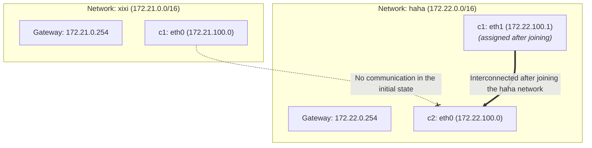

# Docker in Practice: Container Isolation and Cross-Network Communication with Multiple Bridge Networks

This lab demonstrates how to achieve network isolation in Docker by creating multiple custom Bridge networks, how to use `docker network connect` to dynamically add a container to another network so that containers on different networks can communicate, and finally how to use `docker network disconnect` to detach a network

---

## Lab Topology



---

## 1. Create Multiple Custom Networks

First, look at the list of default networks on the current Docker host

```bash
root@docker02:~# docker network ls
NETWORK ID     NAME      DRIVER    SCOPE
2cca2f2fcd8d   bridge    bridge    local
d480eece0b34   host      host      local
73e2eaa95d1e   none      null      local
```

### Create the network `xixi`
- Subnet: `172.21.0.0/16`
- IP range: `172.21.100.0/24`
- Gateway: `172.21.0.254`

```bash
root@docker02:~# docker network create -d bridge --gateway 172.21.0.254 --ip-range 172.21.100.0/24 --subnet 172.21.0.0/16 xixi
583cf675a306b955c36d2749828569626f1629dafb72f938436fec670633bb6b
```

### Create the network `haha`
- Subnet: `172.22.0.0/16`
- IP range: `172.22.100.0/24`
- Gateway: `172.22.0.254`

```bash
root@docker02:~# docker network create -d bridge --gateway 172.22.0.254 --ip-range 172.22.100.0/24 --subnet 172.22.0.0/16 haha
609c120d64e622b3f5a6d955da3826854190a4dd10d1ada75513e42bf3aaec4b
```

### Verify the Network Creation Result

```bash
root@docker02:~# docker network ls
NETWORK ID     NAME      DRIVER    SCOPE
2cca2f2fcd8d   bridge    bridge    local
609c120d64e6   haha      bridge    local
d480eece0b34   host      host      local
73e2eaa95d1e   none      null      local
583cf675a306   xixi      bridge    local
```

### View Detailed Network Information

View the `xixi` network configuration

```bash
root@docker02:~# docker network inspect xixi
[
    {
        "Name": "xixi",
        "Id": "583cf675a306b955c36d2749828569626f1629dafb72f938436fec670633bb6b",
        "Created": "2026-10-27T05:08:44.825169015Z",
        "Scope": "local",
        "Driver": "bridge",
        "EnableIPv6": false,
        "IPAM": {
            "Driver": "default",
            "Options": {},
            "Config": [
                {
                    "Subnet": "172.21.0.0/16",
                    "IPRange": "172.21.100.0/24",
                    "Gateway": "172.21.0.254"
                }
            ]
        },
        "Internal": false,
        "Attachable": false,
        "Ingress": false,
        "ConfigFrom": {
            "Network": ""
        },
        "ConfigOnly": false,
        "Containers": {},
        "Options": {},
        "Labels": {}
    }
]
```

View the `haha` network configuration

```bash
root@docker02:~# docker network inspect haha
[
    {
        "Name": "haha",
        "Id": "609c120d64e622b3f5a6d955da3826854190a4dd10d1ada75513e42bf3aaec4b",
        "Created": "2026-10-27T05:09:05.773564638Z",
        "Scope": "local",
        "Driver": "bridge",
        "EnableIPv6": false,
        "IPAM": {
            "Driver": "default",
            "Options": {},
            "Config": [
                {
                    "Subnet": "172.22.0.0/16",
                    "IPRange": "172.22.100.0/24",
                    "Gateway": "172.22.0.254"
                }
            ]
        },
        "Internal": false,
        "Attachable": false,
        "Ingress": false,
        "ConfigFrom": {
            "Network": ""
        },
        "ConfigOnly": false,
        "Containers": {},
        "Options": {},
        "Labels": {}
    }
]
```

---

## 2. Start Containers and Join Different Networks

### Start container `c1` and join the `xixi` network

```bash
root@docker02:~# docker run -d --name c1 --network xixi uhub.service.ucloud.cn/dawn/apps:v1
631c6c8f1f8cd444c66d88915acabe1c8c44041a0bb827907709ef3c77521d35
```

View the network interface information of container `c1`

```bash
root@docker02:~# docker exec c1 ifconfig
eth0      Link encap:Ethernet  HWaddr 02:42:AC:15:64:00
          inet addr:172.21.100.0  Bcast:172.21.255.255  Mask:255.255.0.0
          UP BROADCAST RUNNING MULTICAST  MTU:1500  Metric:1
          RX packets:14 errors:0 dropped:0 overruns:0 frame:0
          TX packets:0 errors:0 dropped:0 overruns:0 carrier:0
          collisions:0 txqueuelen:0
          RX bytes:1252 (1.2 KiB)  TX bytes:0 (0.0 B)

lo        Link encap:Local Loopback
          inet addr:127.0.0.1  Mask:255.0.0.0
          inet6 addr: ::1/128 Scope:Host
          UP LOOPBACK RUNNING  MTU:65536  Metric:1
          RX packets:0 errors:0 dropped:0 overruns:0 frame:0
          TX packets:0 errors:0 dropped:0 overruns:0 carrier:0
          collisions:0 txqueuelen:1000
          RX bytes:0 (0.0 B)  TX bytes:0 (0.0 B)
```
`c1`'s `eth0` was assigned the IP `172.21.100.0`

### Start container `c2` and join the `haha` network

```bash
root@docker02:~# docker run -d --name c2 --network haha uhub.service.ucloud.cn/dawn/apps:v1
212f2ec99af465975a8b63bf83a3b50adce8414e776c4bc766434a27a1b421e0
```

View the network interface information and routing table of container `c2`

```bash
root@docker02:~# docker exec c2 ifconfig
eth0      Link encap:Ethernet  HWaddr 02:42:AC:16:64:00
          inet addr:172.22.100.0  Bcast:172.22.255.255  Mask:255.255.0.0
          UP BROADCAST RUNNING MULTICAST  MTU:1500  Metric:1
          RX packets:13 errors:0 dropped:0 overruns:0 frame:0
          TX packets:0 errors:0 dropped:0 overruns:0 carrier:0
          collisions:0 txqueuelen:0
          RX bytes:1182 (1.1 KiB)  TX bytes:0 (0.0 B)

lo        Link encap:Local Loopback
          inet addr:127.0.0.1  Mask:255.0.0.0
          inet6 addr: ::1/128 Scope:Host
          UP LOOPBACK RUNNING  MTU:65536  Metric:1
          RX packets:0 errors:0 dropped:0 overruns:0 frame:0
          TX packets:0 errors:0 dropped:0 overruns:0 carrier:0
          collisions:0 txqueuelen:1000
          RX bytes:0 (0.0 B)  TX bytes:0 (0.0 B)
```

```bash
root@docker02:~# docker exec -it c2 route -n
Kernel IP routing table
Destination     Gateway         Genmask         Flags Metric Ref    Use Iface
0.0.0.0         172.22.0.254    0.0.0.0         UG    0      0        0 eth0
172.22.0.0      0.0.0.0         255.255.0.0     U     0      0        0 eth0
```
`c2`'s `eth0` was assigned the IP `172.22.100.0`, and its default gateway points to `172.22.0.254`

---

## 3. Test Connectivity Between c1 and c2

Enter container `c1` and run a network connectivity test

```bash
root@docker02:~# docker exec -it c1 sh
```

### Test 1: Resolve by container name and ping

```sh
/ # ping c2
ping: bad address 'c2'
```
Because `c1` and `c2` belong to different custom networks, Docker's built-in DNS service does not resolve container names across networks

### Test 2: Ping by IP address

```sh
/ # ping 172.22.100.0 -c 3
PING 172.22.100.0 (172.22.100.0): 56 data bytes

--- 172.22.100.0 ping statistics ---
3 packets transmitted, 0 packets received, 100% packet loss
```
Different Bridge networks are isolated from each other by Linux iptables rules, so packets cannot pass between them

---

## 4. Add Container c1 to the Same Network as c2

Use the `docker network connect` command to attach container `c1` to the `haha` network

```bash
root@docker02:~# docker network connect haha c1
```

View `c1`'s current network configuration

```bash
root@docker02:~# docker exec c1 ifconfig
eth0      Link encap:Ethernet  HWaddr 02:42:AC:15:64:00
          inet addr:172.21.100.0  Bcast:172.21.255.255  Mask:255.255.0.0
          UP BROADCAST RUNNING MULTICAST  MTU:1500  Metric:1
          RX packets:17 errors:0 dropped:0 overruns:0 frame:0
          TX packets:0 errors:0 dropped:0 overruns:0 carrier:0
          collisions:0 txqueuelen:0
          RX bytes:1462 (1.4 KiB)  TX bytes:0 (0.0 B)

eth1      Link encap:Ethernet  HWaddr 02:42:AC:16:64:01
          inet addr:172.22.100.1  Bcast:172.22.255.255  Mask:255.255.0.0
          UP BROADCAST RUNNING MULTICAST  MTU:1500  Metric:1
          RX packets:8 errors:0 dropped:0 overruns:0 frame:0
          TX packets:0 errors:0 dropped:0 overruns:0 carrier:0
          collisions:0 txqueuelen:0
          RX bytes:656 (656.0 B)  TX bytes:0 (0.0 B)

lo        Link encap:Local Loopback
          inet addr:127.0.0.1  Mask:255.0.0.0
          inet6 addr: ::1/128 Scope:Host
          UP LOOPBACK RUNNING  MTU:65536  Metric:1
          RX packets:0 errors:0 dropped:0 overruns:0 frame:0
          TX packets:0 errors:0 dropped:0 overruns:0 carrier:0
          collisions:0 txqueuelen:1000
          RX bytes:0 (0.0 B)  TX bytes:0 (0.0 B)
```

Container `c1` gained a new NIC `eth1`, assigned the `haha` network IP address `172.22.100.1`. At this point `c1` can communicate on both networks at the same time

---

## 5. Test Connectivity Again

From the host, use `docker exec` to send ping requests to `c2` from inside `c1`

```bash
root@docker02:~# docker exec c1 ping c2 -c 3
PING c2 (172.22.100.0): 56 data bytes
64 bytes from 172.22.100.0: seq=0 ttl=64 time=11.755 ms
64 bytes from 172.22.100.0: seq=1 ttl=64 time=0.082 ms
64 bytes from 172.22.100.0: seq=2 ttl=64 time=0.078 ms

--- c2 ping statistics ---
3 packets transmitted, 3 packets received, 0% packet loss
round-trip min/avg/max = 0.078/3.971/11.755 ms
```

Connectivity succeeded

## 6. Disconnect the Network

After the test, detach `c1` from the `haha` network

```bash
root@docker02:~# docker network disconnect haha c1 
```

Check `c1`'s network configuration again

```bash
root@docker02:~# docker exec c1 ifconfig
eth0      Link encap:Ethernet  HWaddr 02:42:AC:15:64:00
          inet addr:172.21.100.0  Bcast:172.21.255.255  Mask:255.255.0.0
          UP BROADCAST RUNNING MULTICAST  MTU:1500  Metric:1
          RX packets:17 errors:0 dropped:0 overruns:0 frame:0
          TX packets:0 errors:0 dropped:0 overruns:0 carrier:0
          collisions:0 txqueuelen:0
          RX bytes:1462 (1.4 KiB)  TX bytes:0 (0.0 B)

lo        Link encap:Local Loopback
          inet addr:127.0.0.1  Mask:255.0.0.0
          inet6 addr: ::1/128 Scope:Host
          UP LOOPBACK RUNNING  MTU:65536  Metric:1
          RX packets:4 errors:0 dropped:0 overruns:0 frame:0
          TX packets:4 errors:0 dropped:0 overruns:0 carrier:0
          collisions:0 txqueuelen:1000
          RX bytes:210 (210.0 B)  TX bytes:210 (210.0 B)
```

The NIC eth1 has been dynamically removed, and c1 is back to its original state of joining only the xixi network

> Container name DNS resolution only works within the **same custom network**; cross-network connectivity relies on sharing a subnet after `connect`, not on DNS.
