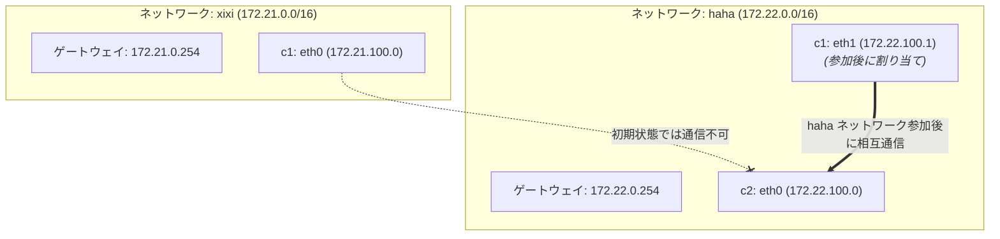

# Docker 実戦：複数 Bridge ネットワークによるコンテナ分離とネットワーク間通信

この検証では、Docker で複数のカスタム Bridge ネットワークを作成してネットワーク分離を実現する方法、`docker network connect` でコンテナを実行中に別のネットワークへ動的に参加させネットワークをまたぐコンテナ間通信を実現する方法、そして最後に `docker network disconnect` でネットワークを切断する方法を実演します

---

## 検証トポロジー



---

## 1. 複数のカスタムネットワークを作成

まず現在の Docker ホストの既定ネットワーク一覧を確認します

```bash
root@docker02:~# docker network ls
NETWORK ID     NAME      DRIVER    SCOPE
2cca2f2fcd8d   bridge    bridge    local
d480eece0b34   host      host      local
73e2eaa95d1e   none      null      local
```

### ネットワーク `xixi` を作成
- セグメント：`172.21.0.0/16`
- IP 範囲：`172.21.100.0/24`
- ゲートウェイ：`172.21.0.254`

```bash
root@docker02:~# docker network create -d bridge --gateway 172.21.0.254 --ip-range 172.21.100.0/24 --subnet 172.21.0.0/16 xixi
583cf675a306b955c36d2749828569626f1629dafb72f938436fec670633bb6b
```

### ネットワーク `haha` を作成
- セグメント：`172.22.0.0/16`
- IP 範囲：`172.22.100.0/24`
- ゲートウェイ：`172.22.0.254`

```bash
root@docker02:~# docker network create -d bridge --gateway 172.22.0.254 --ip-range 172.22.100.0/24 --subnet 172.22.0.0/16 haha
609c120d64e622b3f5a6d955da3826854190a4dd10d1ada75513e42bf3aaec4b
```

### ネットワーク作成結果を確認

```bash
root@docker02:~# docker network ls
NETWORK ID     NAME      DRIVER    SCOPE
2cca2f2fcd8d   bridge    bridge    local
609c120d64e6   haha      bridge    local
d480eece0b34   host      host      local
73e2eaa95d1e   none      null      local
583cf675a306   xixi      bridge    local
```

### ネットワークの詳細を確認

`xixi` ネットワークの設定を確認

```bash
root@docker02:~# docker network inspect xixi
[
    {
        "Name": "xixi",
        "Id": "583cf675a306b955c36d2749828569626f1629dafb72f938436fec670633bb6b",
        "Created": "2026-10-27T05:08:44.825169015Z",
        "Scope": "local",
        "Driver": "bridge",
        "EnableIPv6": false,
        "IPAM": {
            "Driver": "default",
            "Options": {},
            "Config": [
                {
                    "Subnet": "172.21.0.0/16",
                    "IPRange": "172.21.100.0/24",
                    "Gateway": "172.21.0.254"
                }
            ]
        },
        "Internal": false,
        "Attachable": false,
        "Ingress": false,
        "ConfigFrom": {
            "Network": ""
        },
        "ConfigOnly": false,
        "Containers": {},
        "Options": {},
        "Labels": {}
    }
]
```

`haha` ネットワークの設定を確認

```bash
root@docker02:~# docker network inspect haha
[
    {
        "Name": "haha",
        "Id": "609c120d64e622b3f5a6d955da3826854190a4dd10d1ada75513e42bf3aaec4b",
        "Created": "2026-10-27T05:09:05.773564638Z",
        "Scope": "local",
        "Driver": "bridge",
        "EnableIPv6": false,
        "IPAM": {
            "Driver": "default",
            "Options": {},
            "Config": [
                {
                    "Subnet": "172.22.0.0/16",
                    "IPRange": "172.22.100.0/24",
                    "Gateway": "172.22.0.254"
                }
            ]
        },
        "Internal": false,
        "Attachable": false,
        "Ingress": false,
        "ConfigFrom": {
            "Network": ""
        },
        "ConfigOnly": false,
        "Containers": {},
        "Options": {},
        "Labels": {}
    }
]
```

---

## 2. コンテナを起動して別々のネットワークに参加

### コンテナ `c1` を起動して `xixi` ネットワークに参加

```bash
root@docker02:~# docker run -d --name c1 --network xixi uhub.service.ucloud.cn/dawn/apps:v1
631c6c8f1f8cd444c66d88915acabe1c8c44041a0bb827907709ef3c77521d35
```

コンテナ `c1` のネットワークインターフェース情報を確認

```bash
root@docker02:~# docker exec c1 ifconfig
eth0      Link encap:Ethernet  HWaddr 02:42:AC:15:64:00
          inet addr:172.21.100.0  Bcast:172.21.255.255  Mask:255.255.0.0
          UP BROADCAST RUNNING MULTICAST  MTU:1500  Metric:1
          RX packets:14 errors:0 dropped:0 overruns:0 frame:0
          TX packets:0 errors:0 dropped:0 overruns:0 carrier:0
          collisions:0 txqueuelen:0
          RX bytes:1252 (1.2 KiB)  TX bytes:0 (0.0 B)

lo        Link encap:Local Loopback
          inet addr:127.0.0.1  Mask:255.0.0.0
          inet6 addr: ::1/128 Scope:Host
          UP LOOPBACK RUNNING  MTU:65536  Metric:1
          RX packets:0 errors:0 dropped:0 overruns:0 frame:0
          TX packets:0 errors:0 dropped:0 overruns:0 carrier:0
          collisions:0 txqueuelen:1000
          RX bytes:0 (0.0 B)  TX bytes:0 (0.0 B)
```
`c1` の `eth0` に IP `172.21.100.0` が割り当てられました

### コンテナ `c2` を起動して `haha` ネットワークに参加

```bash
root@docker02:~# docker run -d --name c2 --network haha uhub.service.ucloud.cn/dawn/apps:v1
212f2ec99af465975a8b63bf83a3b50adce8414e776c4bc766434a27a1b421e0
```

コンテナ `c2` のネットワークインターフェース情報とルーティングテーブルを確認

```bash
root@docker02:~# docker exec c2 ifconfig
eth0      Link encap:Ethernet  HWaddr 02:42:AC:16:64:00
          inet addr:172.22.100.0  Bcast:172.22.255.255  Mask:255.255.0.0
          UP BROADCAST RUNNING MULTICAST  MTU:1500  Metric:1
          RX packets:13 errors:0 dropped:0 overruns:0 frame:0
          TX packets:0 errors:0 dropped:0 overruns:0 carrier:0
          collisions:0 txqueuelen:0
          RX bytes:1182 (1.1 KiB)  TX bytes:0 (0.0 B)

lo        Link encap:Local Loopback
          inet addr:127.0.0.1  Mask:255.0.0.0
          inet6 addr: ::1/128 Scope:Host
          UP LOOPBACK RUNNING  MTU:65536  Metric:1
          RX packets:0 errors:0 dropped:0 overruns:0 frame:0
          TX packets:0 errors:0 dropped:0 overruns:0 carrier:0
          collisions:0 txqueuelen:1000
          RX bytes:0 (0.0 B)  TX bytes:0 (0.0 B)
```

```bash
root@docker02:~# docker exec -it c2 route -n
Kernel IP routing table
Destination     Gateway         Genmask         Flags Metric Ref    Use Iface
0.0.0.0         172.22.0.254    0.0.0.0         UG    0      0        0 eth0
172.22.0.0      0.0.0.0         255.255.0.0     U     0      0        0 eth0
```
`c2` の `eth0` に IP `172.22.100.0` が割り当てられ、デフォルトゲートウェイは `172.22.0.254` を指します

---

## 3. c1 と c2 の接続性をテスト

コンテナ `c1` に入ってネットワーク接続性をテストします

```bash
root@docker02:~# docker exec -it c1 sh
```

### テスト 1：コンテナ名で名前解決して ping

```sh
/ # ping c2
ping: bad address 'c2'
```
`c1` と `c2` は異なるカスタムネットワークに属するため、Docker 内蔵 DNS はネットワークをまたいでコンテナ名を解決しません

### テスト 2：IP アドレスで ping

```sh
/ # ping 172.22.100.0 -c 3
PING 172.22.100.0 (172.22.100.0): 56 data bytes

--- 172.22.100.0 ping statistics ---
3 packets transmitted, 0 packets received, 100% packet loss
```
異なる Bridge ネットワークは Linux の iptables ルールで分離されているため、パケットは行き来できません

---

## 4. c1 コンテナを c2 と同じネットワークに追加

`docker network connect` コマンドでコンテナ `c1` を `haha` ネットワークに接続します

```bash
root@docker02:~# docker network connect haha c1
```

`c1` の現在のネットワーク設定を確認

```bash
root@docker02:~# docker exec c1 ifconfig
eth0      Link encap:Ethernet  HWaddr 02:42:AC:15:64:00
          inet addr:172.21.100.0  Bcast:172.21.255.255  Mask:255.255.0.0
          UP BROADCAST RUNNING MULTICAST  MTU:1500  Metric:1
          RX packets:17 errors:0 dropped:0 overruns:0 frame:0
          TX packets:0 errors:0 dropped:0 overruns:0 carrier:0
          collisions:0 txqueuelen:0
          RX bytes:1462 (1.4 KiB)  TX bytes:0 (0.0 B)

eth1      Link encap:Ethernet  HWaddr 02:42:AC:16:64:01
          inet addr:172.22.100.1  Bcast:172.22.255.255  Mask:255.255.0.0
          UP BROADCAST RUNNING MULTICAST  MTU:1500  Metric:1
          RX packets:8 errors:0 dropped:0 overruns:0 frame:0
          TX packets:0 errors:0 dropped:0 overruns:0 carrier:0
          collisions:0 txqueuelen:0
          RX bytes:656 (656.0 B)  TX bytes:0 (0.0 B)

lo        Link encap:Local Loopback
          inet addr:127.0.0.1  Mask:255.0.0.0
          inet6 addr: ::1/128 Scope:Host
          UP LOOPBACK RUNNING  MTU:65536  Metric:1
          RX packets:0 errors:0 dropped:0 overruns:0 frame:0
          TX packets:0 errors:0 dropped:0 overruns:0 carrier:0
          collisions:0 txqueuelen:1000
          RX bytes:0 (0.0 B)  TX bytes:0 (0.0 B)
```

コンテナ `c1` に NIC `eth1` が追加され、`haha` ネットワークの IP アドレス `172.22.100.1` が割り当てられました。これで `c1` は 2 つのネットワークの通信能力を同時に持ちます

---

## 5. 接続性を再テスト

ホストから直接 `docker exec` を使い、`c1` 内部から `c2` へ ping を送信します

```bash
root@docker02:~# docker exec c1 ping c2 -c 3
PING c2 (172.22.100.0): 56 data bytes
64 bytes from 172.22.100.0: seq=0 ttl=64 time=11.755 ms
64 bytes from 172.22.100.0: seq=1 ttl=64 time=0.082 ms
64 bytes from 172.22.100.0: seq=2 ttl=64 time=0.078 ms

--- c2 ping statistics ---
3 packets transmitted, 3 packets received, 0% packet loss
round-trip min/avg/max = 0.078/3.971/11.755 ms
```

接続成功

## 6. ネットワークを切断

テスト完了後、`c1` を `haha` ネットワークから切断します

```bash
root@docker02:~# docker network disconnect haha c1 
```

`c1` のネットワーク設定を再確認

```bash
root@docker02:~# docker exec c1 ifconfig
eth0      Link encap:Ethernet  HWaddr 02:42:AC:15:64:00
          inet addr:172.21.100.0  Bcast:172.21.255.255  Mask:255.255.0.0
          UP BROADCAST RUNNING MULTICAST  MTU:1500  Metric:1
          RX packets:17 errors:0 dropped:0 overruns:0 frame:0
          TX packets:0 errors:0 dropped:0 overruns:0 carrier:0
          collisions:0 txqueuelen:0
          RX bytes:1462 (1.4 KiB)  TX bytes:0 (0.0 B)

lo        Link encap:Local Loopback
          inet addr:127.0.0.1  Mask:255.0.0.0
          inet6 addr: ::1/128 Scope:Host
          UP LOOPBACK RUNNING  MTU:65536  Metric:1
          RX packets:4 errors:0 dropped:0 overruns:0 frame:0
          TX packets:4 errors:0 dropped:0 overruns:0 carrier:0
          collisions:0 txqueuelen:1000
          RX bytes:210 (210.0 B)  TX bytes:210 (210.0 B)
```

NIC eth1 は動的に削除され、c1 は xixi ネットワークのみに参加していた元の状態に戻りました

> コンテナ名の DNS 解決は**同一のカスタムネットワーク**内でのみ有効です。ネットワーク間の接続は `connect` 後にセグメントを共有することで実現され、DNS によるものではありません。
