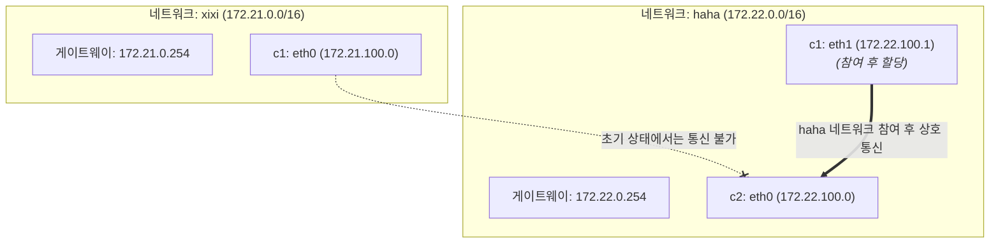

# Docker 실전: 다중 Bridge 네트워크 기반 컨테이너 격리와 네트워크 간 통신

이 실험에서는 Docker 에서 커스텀 Bridge 네트워크를 여러 개 만들어 네트워크 격리를 구현하는 방법, `docker network connect` 로 컨테이너를 실행 중에 다른 네트워크에 동적으로 참여시켜 네트워크 간 컨테이너 통신을 구현하는 방법, 마지막으로 `docker network disconnect` 로 네트워크를 끊는 방법을 보여줍니다

---

## 실험 토폴로지



---

## 1. 여러 개의 커스텀 네트워크 생성

먼저 현재 Docker 호스트의 기본 네트워크 목록을 확인한다

```bash
root@docker02:~# docker network ls
NETWORK ID     NAME      DRIVER    SCOPE
2cca2f2fcd8d   bridge    bridge    local
d480eece0b34   host      host      local
73e2eaa95d1e   none      null      local
```

### 네트워크 `xixi` 생성
- 대역: `172.21.0.0/16`
- IP 범위: `172.21.100.0/24`
- 게이트웨이: `172.21.0.254`

```bash
root@docker02:~# docker network create -d bridge --gateway 172.21.0.254 --ip-range 172.21.100.0/24 --subnet 172.21.0.0/16 xixi
583cf675a306b955c36d2749828569626f1629dafb72f938436fec670633bb6b
```

### 네트워크 `haha` 생성
- 대역: `172.22.0.0/16`
- IP 범위: `172.22.100.0/24`
- 게이트웨이: `172.22.0.254`

```bash
root@docker02:~# docker network create -d bridge --gateway 172.22.0.254 --ip-range 172.22.100.0/24 --subnet 172.22.0.0/16 haha
609c120d64e622b3f5a6d955da3826854190a4dd10d1ada75513e42bf3aaec4b
```

### 네트워크 생성 결과 확인

```bash
root@docker02:~# docker network ls
NETWORK ID     NAME      DRIVER    SCOPE
2cca2f2fcd8d   bridge    bridge    local
609c120d64e6   haha      bridge    local
d480eece0b34   host      host      local
73e2eaa95d1e   none      null      local
583cf675a306   xixi      bridge    local
```

### 네트워크 상세 정보 확인

`xixi` 네트워크 설정 확인

```bash
root@docker02:~# docker network inspect xixi
[
    {
        "Name": "xixi",
        "Id": "583cf675a306b955c36d2749828569626f1629dafb72f938436fec670633bb6b",
        "Created": "2026-10-27T05:08:44.825169015Z",
        "Scope": "local",
        "Driver": "bridge",
        "EnableIPv6": false,
        "IPAM": {
            "Driver": "default",
            "Options": {},
            "Config": [
                {
                    "Subnet": "172.21.0.0/16",
                    "IPRange": "172.21.100.0/24",
                    "Gateway": "172.21.0.254"
                }
            ]
        },
        "Internal": false,
        "Attachable": false,
        "Ingress": false,
        "ConfigFrom": {
            "Network": ""
        },
        "ConfigOnly": false,
        "Containers": {},
        "Options": {},
        "Labels": {}
    }
]
```

`haha` 네트워크 설정 확인

```bash
root@docker02:~# docker network inspect haha
[
    {
        "Name": "haha",
        "Id": "609c120d64e622b3f5a6d955da3826854190a4dd10d1ada75513e42bf3aaec4b",
        "Created": "2026-10-27T05:09:05.773564638Z",
        "Scope": "local",
        "Driver": "bridge",
        "EnableIPv6": false,
        "IPAM": {
            "Driver": "default",
            "Options": {},
            "Config": [
                {
                    "Subnet": "172.22.0.0/16",
                    "IPRange": "172.22.100.0/24",
                    "Gateway": "172.22.0.254"
                }
            ]
        },
        "Internal": false,
        "Attachable": false,
        "Ingress": false,
        "ConfigFrom": {
            "Network": ""
        },
        "ConfigOnly": false,
        "Containers": {},
        "Options": {},
        "Labels": {}
    }
]
```

---

## 2. 컨테이너를 실행해 서로 다른 네트워크에 참여

### 컨테이너 `c1` 을 실행해 `xixi` 네트워크에 참여

```bash
root@docker02:~# docker run -d --name c1 --network xixi uhub.service.ucloud.cn/dawn/apps:v1
631c6c8f1f8cd444c66d88915acabe1c8c44041a0bb827907709ef3c77521d35
```

컨테이너 `c1` 의 네트워크 인터페이스 정보 확인

```bash
root@docker02:~# docker exec c1 ifconfig
eth0      Link encap:Ethernet  HWaddr 02:42:AC:15:64:00
          inet addr:172.21.100.0  Bcast:172.21.255.255  Mask:255.255.0.0
          UP BROADCAST RUNNING MULTICAST  MTU:1500  Metric:1
          RX packets:14 errors:0 dropped:0 overruns:0 frame:0
          TX packets:0 errors:0 dropped:0 overruns:0 carrier:0
          collisions:0 txqueuelen:0
          RX bytes:1252 (1.2 KiB)  TX bytes:0 (0.0 B)

lo        Link encap:Local Loopback
          inet addr:127.0.0.1  Mask:255.0.0.0
          inet6 addr: ::1/128 Scope:Host
          UP LOOPBACK RUNNING  MTU:65536  Metric:1
          RX packets:0 errors:0 dropped:0 overruns:0 frame:0
          TX packets:0 errors:0 dropped:0 overruns:0 carrier:0
          collisions:0 txqueuelen:1000
          RX bytes:0 (0.0 B)  TX bytes:0 (0.0 B)
```
`c1` 의 `eth0` 에 IP `172.21.100.0` 이 할당되었다

### 컨테이너 `c2` 를 실행해 `haha` 네트워크에 참여

```bash
root@docker02:~# docker run -d --name c2 --network haha uhub.service.ucloud.cn/dawn/apps:v1
212f2ec99af465975a8b63bf83a3b50adce8414e776c4bc766434a27a1b421e0
```

컨테이너 `c2` 의 네트워크 인터페이스 정보와 라우팅 테이블 확인

```bash
root@docker02:~# docker exec c2 ifconfig
eth0      Link encap:Ethernet  HWaddr 02:42:AC:16:64:00
          inet addr:172.22.100.0  Bcast:172.22.255.255  Mask:255.255.0.0
          UP BROADCAST RUNNING MULTICAST  MTU:1500  Metric:1
          RX packets:13 errors:0 dropped:0 overruns:0 frame:0
          TX packets:0 errors:0 dropped:0 overruns:0 carrier:0
          collisions:0 txqueuelen:0
          RX bytes:1182 (1.1 KiB)  TX bytes:0 (0.0 B)

lo        Link encap:Local Loopback
          inet addr:127.0.0.1  Mask:255.0.0.0
          inet6 addr: ::1/128 Scope:Host
          UP LOOPBACK RUNNING  MTU:65536  Metric:1
          RX packets:0 errors:0 dropped:0 overruns:0 frame:0
          TX packets:0 errors:0 dropped:0 overruns:0 carrier:0
          collisions:0 txqueuelen:1000
          RX bytes:0 (0.0 B)  TX bytes:0 (0.0 B)
```

```bash
root@docker02:~# docker exec -it c2 route -n
Kernel IP routing table
Destination     Gateway         Genmask         Flags Metric Ref    Use Iface
0.0.0.0         172.22.0.254    0.0.0.0         UG    0      0        0 eth0
172.22.0.0      0.0.0.0         255.255.0.0     U     0      0        0 eth0
```
`c2` 의 `eth0` 에 IP `172.22.100.0` 이 할당되었고 기본 게이트웨이는 `172.22.0.254` 를 가리킨다

---

## 3. c1 과 c2 연결성 테스트

컨테이너 `c1` 안으로 들어가 네트워크 연결성을 테스트한다

```bash
root@docker02:~# docker exec -it c1 sh
```

### 테스트 1: 컨테이너 이름으로 해석 후 ping

```sh
/ # ping c2
ping: bad address 'c2'
```
`c1` 과 `c2` 는 서로 다른 커스텀 네트워크에 속하므로 Docker 내장 DNS 는 네트워크를 넘어 컨테이너 이름을 해석하지 않는다

### 테스트 2: IP 주소로 ping

```sh
/ # ping 172.22.100.0 -c 3
PING 172.22.100.0 (172.22.100.0): 56 data bytes

--- 172.22.100.0 ping statistics ---
3 packets transmitted, 0 packets received, 100% packet loss
```
서로 다른 Bridge 네트워크는 Linux iptables 규칙으로 격리되어 있어 패킷이 오갈 수 없다

---

## 4. c1 컨테이너를 c2 와 같은 네트워크에 추가

`docker network connect` 명령으로 컨테이너 `c1` 을 `haha` 네트워크에 연결한다

```bash
root@docker02:~# docker network connect haha c1
```

`c1` 의 현재 네트워크 설정 확인

```bash
root@docker02:~# docker exec c1 ifconfig
eth0      Link encap:Ethernet  HWaddr 02:42:AC:15:64:00
          inet addr:172.21.100.0  Bcast:172.21.255.255  Mask:255.255.0.0
          UP BROADCAST RUNNING MULTICAST  MTU:1500  Metric:1
          RX packets:17 errors:0 dropped:0 overruns:0 frame:0
          TX packets:0 errors:0 dropped:0 overruns:0 carrier:0
          collisions:0 txqueuelen:0
          RX bytes:1462 (1.4 KiB)  TX bytes:0 (0.0 B)

eth1      Link encap:Ethernet  HWaddr 02:42:AC:16:64:01
          inet addr:172.22.100.1  Bcast:172.22.255.255  Mask:255.255.0.0
          UP BROADCAST RUNNING MULTICAST  MTU:1500  Metric:1
          RX packets:8 errors:0 dropped:0 overruns:0 frame:0
          TX packets:0 errors:0 dropped:0 overruns:0 carrier:0
          collisions:0 txqueuelen:0
          RX bytes:656 (656.0 B)  TX bytes:0 (0.0 B)

lo        Link encap:Local Loopback
          inet addr:127.0.0.1  Mask:255.0.0.0
          inet6 addr: ::1/128 Scope:Host
          UP LOOPBACK RUNNING  MTU:65536  Metric:1
          RX packets:0 errors:0 dropped:0 overruns:0 frame:0
          TX packets:0 errors:0 dropped:0 overruns:0 carrier:0
          collisions:0 txqueuelen:1000
          RX bytes:0 (0.0 B)  TX bytes:0 (0.0 B)
```

컨테이너 `c1` 에 NIC `eth1` 이 새로 생기고 `haha` 네트워크의 IP 주소 `172.22.100.1` 이 할당되었다. 이제 `c1` 은 두 네트워크의 통신 능력을 동시에 가진다

---

## 5. 연결성 재테스트

호스트에서 바로 `docker exec` 를 사용해 `c1` 내부에서 `c2` 로 ping 요청을 보낸다

```bash
root@docker02:~# docker exec c1 ping c2 -c 3
PING c2 (172.22.100.0): 56 data bytes
64 bytes from 172.22.100.0: seq=0 ttl=64 time=11.755 ms
64 bytes from 172.22.100.0: seq=1 ttl=64 time=0.082 ms
64 bytes from 172.22.100.0: seq=2 ttl=64 time=0.078 ms

--- c2 ping statistics ---
3 packets transmitted, 3 packets received, 0% packet loss
round-trip min/avg/max = 0.078/3.971/11.755 ms
```

연결 성공

## 6. 네트워크 연결 해제

테스트가 끝나면 `c1` 을 `haha` 네트워크에서 분리한다

```bash
root@docker02:~# docker network disconnect haha c1 
```

`c1` 의 네트워크 설정 재확인

```bash
root@docker02:~# docker exec c1 ifconfig
eth0      Link encap:Ethernet  HWaddr 02:42:AC:15:64:00
          inet addr:172.21.100.0  Bcast:172.21.255.255  Mask:255.255.0.0
          UP BROADCAST RUNNING MULTICAST  MTU:1500  Metric:1
          RX packets:17 errors:0 dropped:0 overruns:0 frame:0
          TX packets:0 errors:0 dropped:0 overruns:0 carrier:0
          collisions:0 txqueuelen:0
          RX bytes:1462 (1.4 KiB)  TX bytes:0 (0.0 B)

lo        Link encap:Local Loopback
          inet addr:127.0.0.1  Mask:255.0.0.0
          inet6 addr: ::1/128 Scope:Host
          UP LOOPBACK RUNNING  MTU:65536  Metric:1
          RX packets:4 errors:0 dropped:0 overruns:0 frame:0
          TX packets:4 errors:0 dropped:0 overruns:0 carrier:0
          collisions:0 txqueuelen:1000
          RX bytes:210 (210.0 B)  TX bytes:210 (210.0 B)
```

NIC eth1 이 동적으로 제거되어 c1 은 xixi 네트워크에만 참여하던 원래 상태로 돌아갔다

> 컨테이너 이름 DNS 해석은 **같은 커스텀 네트워크** 안에서만 동작한다. 네트워크 간 통신은 `connect` 후 대역을 공유하는 데서 오며 DNS 덕분이 아니다.
