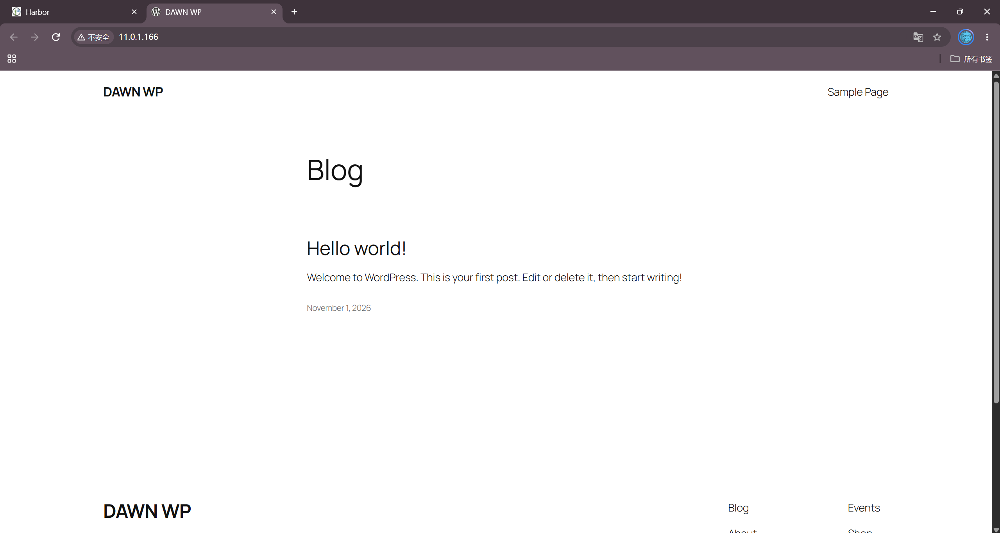
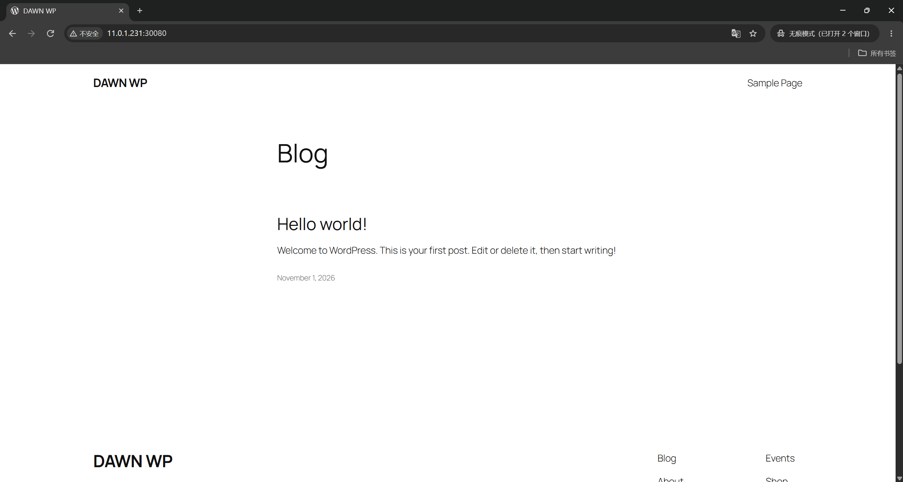

# K8S External Service Integration Practice: Manual Endpoints Mapping External MySQL with WordPress End-to-End Linkage

---

## 1. Starting the MySQL Container

Run the MySQL container directly with `--network host` on the harbor node outside the cluster (bypassing K8S and without consuming Pod IPs):

```bash
[root@harbor ~]# docker run -d --network host --name mysql-server -e MYSQL_ROOT_PASSWORD=dawn -e MYSQL_DATABASE=dawn_wp -e MYSQL_USER=dawn -e MYSQL_PASSWORD=123 harbor:443/dawn-db/mysql:8.3.0-oracle
522d39cef2e365592b5f1b0e46eaf577c37e80018048fd299cc7c905c2dc9818

[root@harbor ~]# docker ps --format 'table {{.Names}}	{{.Status}}'
NAMES               STATUS
mysql-server        Up 10 seconds
nginx               Up 7 hours (healthy)

[root@harbor ~]# ss -ntl | grep -E '3306|33060'
LISTEN 0      151                *:3306             *:*
LISTEN 0      70                 *:33060            *:*
```

When MySQL 8.3 starts for the first time, it needs to initialize the data directory, so it takes some time before port 3306 starts listening.

Verifying databases and users:

```bash
[root@harbor ~]# docker exec -it mysql-server mysql -pdawn
mysql> SHOW DATABASES;
+--------------------+
| Database           |
+--------------------+
| information_schema |
| mysql              |
| dawn_wp            |
| performance_schema |
| sys                |
+--------------------+
5 rows in set (0.01 sec)

mysql> SELECT user,host,plugin FROM mysql.user;
+------------------+-----------+-----------------------+
| user             | host      | plugin                |
+------------------+-----------+-----------------------+
| dawn             | %         | caching_sha2_password |
| root             | %         | caching_sha2_password |
| mysql.infoschema | localhost | caching_sha2_password |
| mysql.session    | localhost | caching_sha2_password |
| mysql.sys        | localhost | caching_sha2_password |
| root             | localhost | caching_sha2_password |
+------------------+-----------+-----------------------+
6 rows in set (0.01 sec)
```

The host for `dawn@%` and `root@%` is `%`—allowing connections from any IP. This is the prerequisite for K8S Pods (10.100.x.x network segment) to connect to the external MySQL.

---

## 2. Creating K8S Cluster ep Resources to Map External Service

```bash
[root@master 02-ep-MySQL]# cat 01-ep-svc-mysql.yaml
```

```yaml
apiVersion: v1
kind: Endpoints
metadata:
  name: dawn-mysql
subsets:
- addresses:
  - ip: 11.0.1.250
  ports:
  - port: 3306
    name: mysql

---

apiVersion: v1
kind: Service
metadata:
  name: dawn-mysql
spec:
  type: ClusterIP
  ports:
  - port: 3306
    name: mysql
```

```bash
[root@master 02-ep-MySQL]# kubectl apply -f 01-ep-svc-mysql.yaml
endpoints/dawn-mysql created
service/dawn-mysql created

[root@master 02-ep-MySQL]# kubectl describe -f 01-ep-svc-mysql.yaml
Name:         dawn-mysql
Namespace:    default
Subsets:
  Addresses:          11.0.1.250
  NotReadyAddresses:  <none>
  Ports:
    Name   Port  Protocol
    ----   ----  --------
    mysql  3306  TCP
```

```
Name:              dawn-mysql
Selector:          <none>
Type:              ClusterIP
IP:                10.200.106.229
Port:              mysql  3306/TCP
Endpoints:         11.0.1.250:3306
```

With a selector-less svc + manual ep designating the external IP, Pods inside the cluster can access the external MySQL using a single internal domain name `dawn-mysql`.

---

## 3. Creating Deployment Resource (WordPress 3 Replicas)

```bash
[root@master 02-ep-MySQL]# cat 02-deploy-wordpress.yaml
```

```yaml
apiVersion: apps/v1
kind: Deployment
metadata:
  name: deploy-wordpress
spec:
  replicas: 3
  selector:
    matchLabels:
      apps: wp
  template:
    metadata:
      labels:
        apps: wp
    spec:
      containers:
      - image: harbor:443/dawn-web/wordpress:latest
        name: wp
        env:
        - name: WORDPRESS_DB_HOST
          value: dawn-mysql
        - name: WORDPRESS_DB_NAME
          value: dawn_wp
        - name: WORDPRESS_DB_USER
          value: dawn
        - name: WORDPRESS_DB_PASSWORD
          value: "123"
        # 动态站点地址：跟随请求的 Host（LB IP / NodePort 均可访问）
        - name: WORDPRESS_CONFIG_EXTRA
          value: |
            define('WP_HOME','http://'.$_SERVER['HTTP_HOST']);
            define('WP_SITEURL','http://'.$_SERVER['HTTP_HOST']);
```

```bash
[root@master 02-ep-MySQL]# kubectl apply -f 02-deploy-wordpress.yaml
deployment.apps/deploy-wordpress created

[root@master 02-ep-MySQL]# kubectl rollout status deploy deploy-wordpress
deployment "deploy-wordpress" successfully rolled out

[root@master 02-ep-MySQL]# kubectl get pods -o wide --show-labels -l apps=wp
NAME                                READY   STATUS    RESTARTS   AGE   IP             NODE       LABELS
deploy-wordpress-7c56894bf8-6cvjw   1/1     Running   0          27s   10.100.1.139   worker01   apps=wp,pod-template-hash=7c56894bf8
deploy-wordpress-7c56894bf8-gxj42   1/1     Running   0          27s   10.100.2.135   worker02   apps=wp,pod-template-hash=7c56894bf8
deploy-wordpress-7c56894bf8-m28kd   1/1     Running   0          27s   10.100.1.138   worker01   apps=wp,pod-template-hash=7c56894bf8
```

When reapplying later with `WORDPRESS_CONFIG_EXTRA` to fix the NodePort issue, the Deployment performs a rolling update, and the Pod template hash changes accordingly:

```bash
# 后补 WORDPRESS_CONFIG_EXTRA 后再次 apply
[root@master 02-ep-MySQL]# kubectl apply -f 02-deploy-wordpress.yaml
deployment.apps/deploy-wordpress configured

[root@master 02-ep-MySQL]# kubectl rollout status deploy deploy-wordpress
deployment "deploy-wordpress" successfully rolled out

[root@master 02-ep-MySQL]# kubectl get pods -l apps=wp
NAME                                READY   STATUS    RESTARTS   AGE
deploy-wordpress-5748f7c87-5xsh5   1/1     Running   0          3m34s
deploy-wordpress-5748f7c87-gdm7x   1/1     Running   0          3m37s
deploy-wordpress-5748f7c87-k8zbs   1/1     Running   0          3m29s

# exec进新Pod验证环境变量真实生效
[root@master 02-ep-MySQL]# kubectl exec deploy-wordpress-5748f7c87-5xsh5 -- printenv | grep WORDPRESS_CONFIG_EXTRA
WORDPRESS_CONFIG_EXTRA=define('WP_HOME','http://'.$_SERVER['HTTP_HOST']);
define('WP_SITEURL','http://'.$_SERVER['HTTP_HOST']);
```

`WORDPRESS_DB_HOST=dawn-mysql` is the svc name created in step two—when Pods connect to the "database", they are actually connecting to the svc, which ep forwards to the real MySQL outside the cluster.

---

## 4. Creating Service to Expose WordPress

```bash
[root@master 02-ep-MySQL]# cat 03-svc-lb-wp.yaml
```

```yaml
apiVersion: v1
kind: Service
metadata:
  name: wp-svc-lb
spec:
  type: LoadBalancer
  loadBalancerIP: 11.0.1.166
  selector:
    apps: wp
  ports:
  - port: 80
    targetPort: 80
    nodePort: 30080
```

```bash
[root@master 02-ep-MySQL]# kubectl apply -f 03-svc-lb-wp.yaml
service/wp-svc-lb created

[root@master 02-ep-MySQL]# kubectl describe svc wp-svc-lb
LoadBalancer Ingress:     11.0.1.166
Port:                     <unset>  80/TCP
TargetPort:               80/TCP
NodePort:                 <unset>  30080/TCP
Endpoints:                10.100.1.138:80,10.100.1.139:80,10.100.2.135:80
Events:
  Normal  IPAllocated   metallb-controller  Assigned IP ["11.0.1.166"]
  Normal  nodeAssigned  metallb-speaker     announcing from node "worker02" with protocol "layer2"
```

---

## 5. Accessing WebUI and Verifying Full-Chain Connectivity

### 5.1 Accessing the Installation Page

```bash
[root@master ~]# curl -s -i http://11.0.1.166/ | head -8
HTTP/1.1 302 Found
Server: Apache/2.4.69 (Debian)
X-Powered-By: PHP/8.3.36
X-Redirect-By: WordPress
Location: http://11.0.1.166/wp-admin/install.php
```

### 5.2 Completing Installation (Writing to DB to Verify Connectivity)

Merely opening the installation page does not prove database connectivity (the WP installation page displays even without a DB).



### 5.3 Evidence: Data Stored in MySQL Outside the Cluster

```bash
[root@harbor ~]# docker exec -i mysql-server mysql -uroot -pdawn -e 'SHOW TABLES IN dawn_wp;'
+-----------------------+
| Tables_in_dawn_wp     |
+-----------------------+
| wp_commentmeta        |
| wp_comments           |
| wp_links              |
| wp_options            |
| wp_postmeta           |
| wp_posts              |
| wp_term_relationships |
| wp_term_taxonomy      |
| wp_termmeta           |
| wp_terms              |
| wp_usermeta           |
| wp_users              |
+-----------------------+

[root@harbor ~]# docker exec -i mysql-server mysql -uroot -pdawn -N -e 'SELECT option_value FROM dawn_wp.wp_options WHERE option_name="blogname";'
DAWN WP
```

All 11 WP tables are created in the `dawn_wp` database of the MySQL outside the cluster, and the site title `DAWN WP` is read directly from the database.

### 5.4 NodePort Verification

```bash
[root@master ~]# curl -s -o /dev/null -w '231:30080 = %{http_code}
' http://11.0.1.231:30080/
231:30080 = 200
```

Browser access:

NodePort: http://11.0.1.231:30080/ , http://11.0.1.232:30080/ , http://11.0.1.233:30080/



The database resides completely outside K8S. Inside the cluster, the external service is incorporated through the "selector-less svc + manual ep" mechanism, completely transparent to the Pod side.
