# K8S 및 Jenkins CI/CD 지속적 통합 실전: Harbor 연동, 파라미터 빌드 및 원클릭 롤백


## 1. Jenkins 환경 배포

### 1. 표준 시간대 설정

```bash
[root@jenkins ~]# ln -svf /usr/share/zoneinfo/Asia/Shanghai /etc/localtime
'/etc/localtime' -> '/usr/share/zoneinfo/Asia/Shanghai'
```

### 2. JDK 17 설치

```bash
[root@jenkins ~]# mkdir -pv /dawn/softwares
[root@jenkins ~]# tar xf /dawn/softwares/jdk-17_linux-x64_bin.tar.gz -C /dawn/softwares/
[root@jenkins ~]# cat /etc/profile.d/jdk.sh
export JAVA_HOME=/dawn/softwares/jdk-17.0.8
export PATH=/dawn/softwares/jdk-17.0.8/bin:/usr/local/sbin:/usr/local/bin:/usr/sbin:/usr/bin:/sbin:/bin
[root@jenkins ~]# source /etc/profile.d/jdk.sh
[root@jenkins ~]# java --version
java 17.0.8 2023-07-18 LTS
Java(TM) SE Runtime Environment (build 17.0.8+9-LTS-211)
Java HotSpot(TM) 64-Bit Server VM (build 17.0.8+9-LTS-211, mixed mode, sharing)
```

### 2. fontconfig 및 의존성 패키지 설치

```bash
[root@jenkins ~]# apt-get update
[root@jenkins ~]# apt-get -y install fontconfig
```

### 3. Jenkins 설치 (오프라인 deb)

```bash
[root@jenkins ~]# dpkg -i /dawn/softwares/jenkins_2.426.3_all.deb
```

### 4. Jenkins 시작 스크립트 수정

```bash
[root@jenkins ~]# vim /lib/systemd/system/jenkins.service
```

수정 내용:

`User=root` (기존 jenkins)

`Group=root` (기존 jenkins)

`Environment="JENKINS_HOME=/var/lib/jenkins"` 다음 줄에 `Environment="JAVA_HOME=/dawn/softwares/jdk-17.0.8"` 추가

```bash
[root@jenkins ~]# systemctl daemon-reload
[root@jenkins ~]# systemctl restart jenkins
[root@jenkins ~]# systemctl is-active jenkins
active
```

### 5. 초기 관리자 비밀번호 확인

```bash
[root@jenkins ~]# cat /var/lib/jenkins/secrets/initialAdminPassword
20286530dae640598368e97991038d70
```

### 6. 플러그인 설치 (오프라인 패키지 일괄 가져오기)

```bash
[root@jenkins ~]# mkdir -p /var/lib/jenkins/plugins
[root@jenkins ~]# tar xf /dawn/softwares/dawn-jenkins211-plugins.tar.gz -C /var/lib/jenkins/plugins/
[root@jenkins ~]# ls /var/lib/jenkins/plugins/ | wc -l
148
[root@jenkins ~]# systemctl restart jenkins
```

148개 플러그인 일괄 가져오기 완료 (Git, Pipeline, Webhook, Ansible, Email, DingTalk, Git Parameter 등 포함), 개별 설치 불필요.

### 7. 미러 가속 설정 및 검색 엔진 주소 변경

```bash
[root@jenkins ~]# sed -i.bak 's#updates.jenkins.io/download#mirror.tuna.tsinghua.edu.cn/jenkins#g' /var/lib/jenkins/updates/default.json
[root@jenkins ~]# sed -i 's#www.google.com#www.baidu.com#g' /var/lib/jenkins/updates/default.json
```

업데이트 사이트 URL: `https://mirror.tuna.tsinghua.edu.cn/jenkins/updates/update-center.json`

### 8. Jenkins WebUI 접속

브라우저에서 `http://11.0.1.211:8080`에 접속하여 초기 비밀번호로 로그인 후 초기 구성을 완료합니다

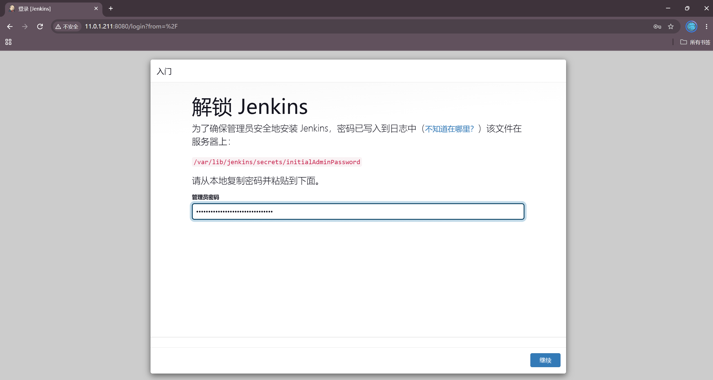

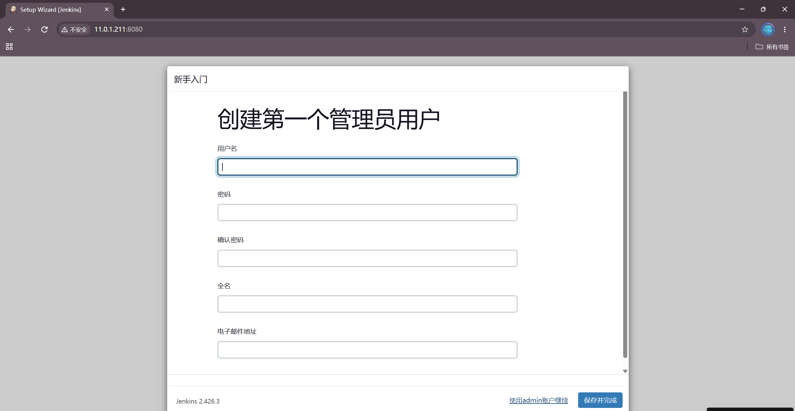

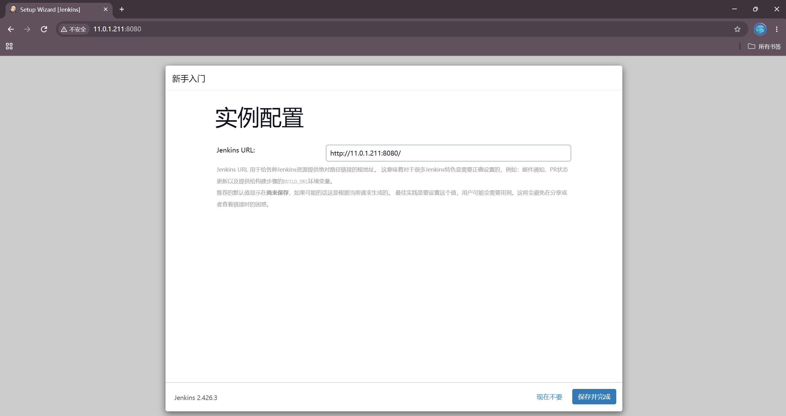

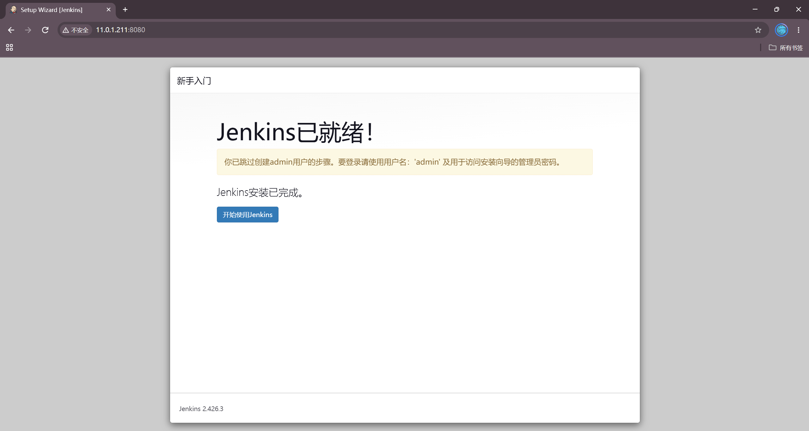

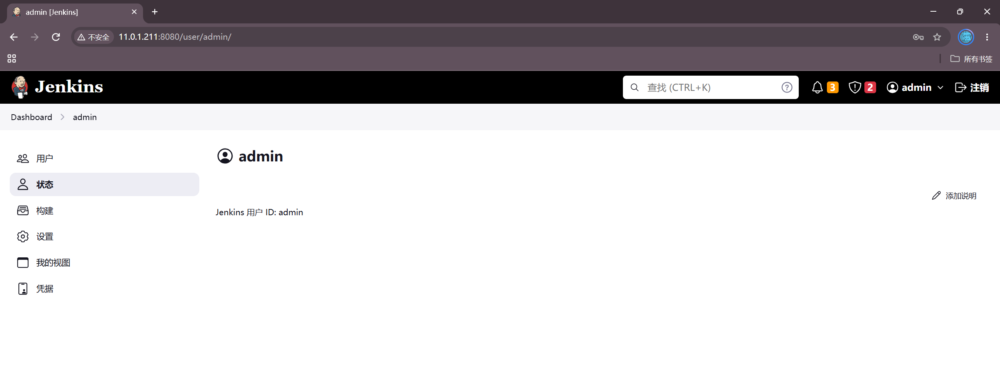

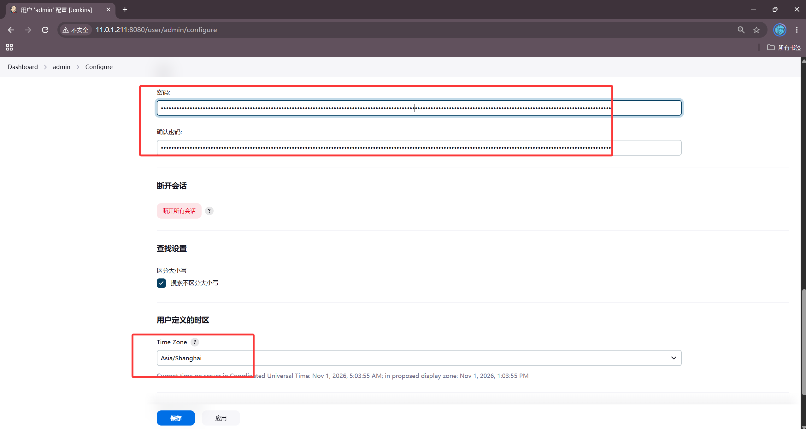

## 2. Jenkins 노드 Docker 설치 및 Harbor 연동

### 1. Docker 설치 (바이너리 오프라인 패키지)

```bash
[root@jenkins ~]# tar xf dawn-docker-compose-binary-install.tar.gz
[root@jenkins ~]# chmod +x install-docker.sh
[root@jenkins ~]# ./install-docker.sh install
Docker Compose version v2.23.0
安装成功...
```

### 2. Harbor 호스트 확인 레코드 추가

```bash
[root@jenkins ~]# echo '11.0.1.250 harbor' >> /etc/hosts
```

### 3. Harbor 자체 서명 클라이언트 인증서 복사

```bash
[root@jenkins ~]# apt-get install -y sshpass
[root@jenkins ~]# mkdir -p /etc/docker/certs.d/harbor
[root@jenkins ~]# sshpass -p '000000' scp -o StrictHostKeyChecking=no root@11.0.1.250:/dawn/softwares/harbor/certs/docker-client/* /etc/docker/certs.d/harbor/
[root@jenkins ~]# ll /etc/docker/certs.d/harbor/
total 20
-rw-r--r-- 1 root root 2037 Oct 31 21:01 ca.crt
-rw-r--r-- 1 root root 2102 Oct 31 21:01 harbor.cert
-rw------- 1 root root 3272 Oct 31 21:01 harbor.key
```

Docker 재시작 후 적용:

```bash
[root@jenkins ~]# systemctl restart docker
[root@jenkins ~]# ln -sf /etc/docker/certs.d/harbor /etc/docker/certs.d/harbor:443
```

### 4. Harbor 로그인

```bash
[root@jenkins ~]# docker login harbor:443 -u admin -p Harbor12345
WARNING! Using --password via the CLI is insecure. Use --password-stdin.
Login Succeeded
```

### 5. Harbor 프로젝트 생성

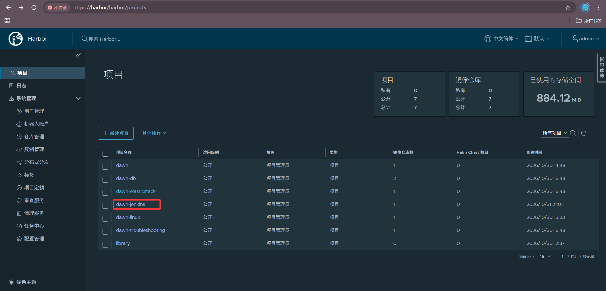

## 3. Jenkins 노드 kubectl 설치 및 K8S 클러스터 연동

### 1. kubectl 설치

```bash
[root@jenkins ~]# mv kubectl-1.23.17 /usr/local/sbin/kubectl
[root@jenkins ~]# chmod +x /usr/local/sbin/kubectl
[root@jenkins ~]# kubectl version --client
Client Version: version.Info{Major:"1", Minor:"23", GitVersion:"v1.23.17", ...}
```

### 2. K8S master의 kubeconfig 복사

```bash
[root@jenkins ~]# mkdir -pv ~/.kube/
[root@jenkins ~]# sshpass -p '000000' scp -o StrictHostKeyChecking=no 11.0.1.231:/root/.kube/config ~/.kube/
[root@jenkins ~]# kubectl get nodes
NAME       STATUS   ROLES                  AGE   VERSION
master     Ready    control-plane,master   32h   v1.23.17
worker01   Ready    <none>                 32h   v1.23.17
worker02   Ready    <none>                 32h   v1.23.17
```

세 개 노드 모두 Ready 상태이며, Jenkins에서 K8S 클러스터를 직접 제어할 수 있는 준비가 완료되었습니다

## 4. 개발자 코드 작성 및 푸시 시뮬레이션

Jenkins 로컬 bare git 저장소 사용: `/dawn/repos/yiliao-dawn.git`

### 1. 프로젝트 소스 코드 압축 해제

```bash
[root@jenkins ~]# unzip dawn-yiliao.zip -d dawn-yiliao-src/
[root@jenkins ~]# cd dawn-yiliao-src
[root@jenkins dawn-yiliao-src]# ll
total 224
drwxr-xr-x 5 root root 4096 Aug  2 16:22 ./
-rw-r--r-- 1 root root 16458 Jun 13  2019 about.html
-rw-r--r-- 1 root root 20149 Jun 13  2019 album.html
-rw-r--r-- 1 root root 29627 Jun 29  2019 index.html
...
drwxr-xr-x 2 root root 4096 Sep 19  2022 css/
drwxr-xr-x 5 root root 4096 Sep 19  2022 images/
drwxr-xr-x 2 root root 4096 Sep 19  2022 js/
```

### 2. Dockerfile 작성

```bash
[root@jenkins dawn-yiliao-src]# cat Dockerfile
FROM harbor:443/dawn/apps:v1

MAINTAINER dawn

LABEL auther=dawn \
      school=czu \
      class=computer01

EXPOSE 80

WORKDIR /usr/share/nginx/html/

ADD . /usr/share/nginx/html/
```

### 3. Git 초기화 및 푸시

```bash
[root@jenkins dawn-yiliao-src]# git config --global user.name "jenkins"
[root@jenkins dawn-yiliao-src]# git config --global user.email "admin@dawn.com"
[root@jenkins dawn-yiliao-src]# git init
[root@jenkins dawn-yiliao-src]# git add .
[root@jenkins dawn-yiliao-src]# git commit -m 'init yiliao v1'
[root@jenkins dawn-yiliao-src]# mkdir -p /dawn/repos
[root@jenkins dawn-yiliao-src]# git clone --bare . /dawn/repos/yiliao-dawn.git
```

## 5. K8S 의료 프로젝트 배포

```bash
[root@jenkins ~]# kubectl create namespace yiliao
namespace/yiliao created

[root@jenkins ~]# kubectl create deploy deploy-yiliao --image=harbor:443/dawn-jenkins/yiliao:v1 --replicas=3 -n yiliao
deployment.apps/deploy-yiliao created

[root@jenkins ~]# kubectl expose deploy deploy-yiliao --port=80 --target-port=80 --type=NodePort --name=yiliao-svc -n yiliao \
>   --overrides='{"spec":{"ports":[{"port":80,"targetPort":80,"nodePort":30080}]}}'
service/yiliao-svc exposed

[root@jenkins ~]# kubectl rollout status deploy deploy-yiliao -n yiliao --timeout=60s
deployment "deploy-yiliao" successfully rolled out

[root@jenkins ~]# kubectl get pods,svc -n yiliao -o wide
NAME                                READY   STATUS    RESTARTS   AGE    IP            NODE
pod/deploy-yiliao-9968fc7c8-4mz5t   1/1     Running   0          5m3s   10.100.1.92   worker01
pod/deploy-yiliao-9968fc7c8-92rxw   1/1     Running   0          5m3s   10.100.2.93   worker02
pod/deploy-yiliao-9968fc7c8-lgnf9   1/1     Running   0          5m3s   10.100.1.91   worker01

NAME                 TYPE       CLUSTER-IP       EXTERNAL-IP   PORT(S)        AGE
service/yiliao-svc   NodePort   10.200.113.198   <none>        80:30080/TCP   0s
```

**접속 테스트**

```bash
[root@jenkins ~]# curl -s http://11.0.1.233:30080 | grep '<title>'
    <title>某某医疗器械有限公司</title>
```

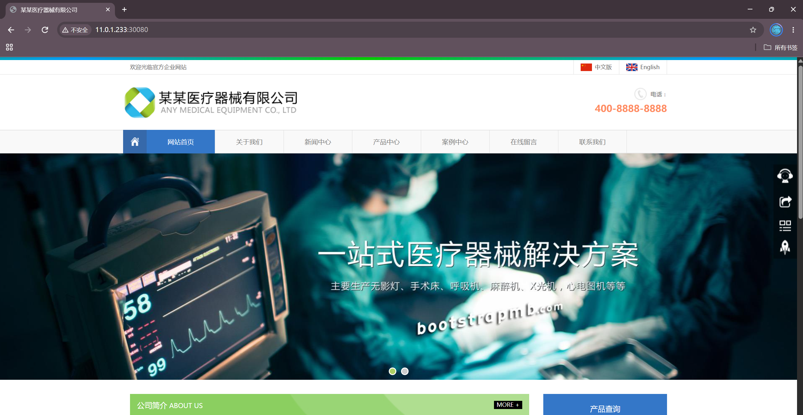

## 6. Jenkins 이미지 빌드 및 Harbor 푸시

### 1. 수동 빌드 테스트

```bash
[root@jenkins dawn-yiliao-src]# docker build -t harbor:443/dawn-jenkins/yiliao:v1 .
Successfully built 9295379ea4af
Successfully tagged harbor:443/dawn-jenkins/yiliao:v1

[root@jenkins dawn-yiliao-src]# docker push harbor:443/dawn-jenkins/yiliao:v1
v1: digest: sha256:ec4de8a336e1dd2cafc89b717b4223576a3549b01fa8094375f4826b47fb4628

[root@jenkins dawn-yiliao-src]# docker images | grep yiliao
harbor:443/dawn-jenkins/yiliao   v1    9295379ea4af   ...   23.2MB
```

## 7. Jenkins 원클릭 K8S 애플리케이션 업데이트 (완전한 CI/CD 프로세스)

### 1. Jenkins 작업 생성

작업명 `dawn-yiliao-cicd` (자유 형식 프로젝트), Shell 빌드 단계:

```bash
cd /root/dawn-yiliao-src && \
docker image build -t harbor:443/dawn-jenkins/yiliao:v2 . && \
docker push harbor:443/dawn-jenkins/yiliao:v2 && \
kubectl -n yiliao set image deploy deploy-yiliao yiliao=harbor:443/dawn-jenkins/yiliao:v2
```

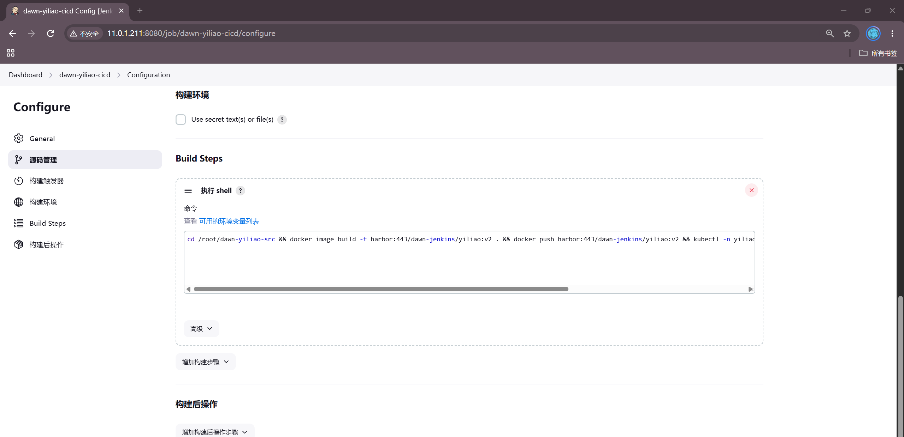

### 2. 코드 변경 시뮬레이션 (v2)

`index.html` 제목 수정 후 v2 이미지 빌드 및 K8S 업데이트:

```bash
[root@jenkins dawn-yiliao-src]# sed -i 's|<title>.*</title>|<title>某某医疗器械有限公司 v2</title>|' index.html
[root@jenkins dawn-yiliao-src]# git add . && git commit -m 'v2: update title'
[root@jenkins dawn-yiliao-src]# git push /dawn/repos/yiliao-dawn.git master
[root@jenkins dawn-yiliao-src]# docker build -t harbor:443/dawn-jenkins/yiliao:v2 .
Successfully built f52deb20e604
Successfully tagged harbor:443/dawn-jenkins/yiliao:v2

[root@jenkins dawn-yiliao-src]# docker push harbor:443/dawn-jenkins/yiliao:v2
v2: digest: sha256:c408f20094f32717fd915e6e3c1cf52ccebe8db32e4d88a8319a781e3696da7b

[root@jenkins dawn-yiliao-src]# kubectl -n yiliao set image deploy deploy-yiliao yiliao=harbor:443/dawn-jenkins/yiliao:v2
deployment.apps/deploy-yiliao image updated

[root@jenkins dawn-yiliao-src]# kubectl rollout status deploy deploy-yiliao -n yiliao --timeout=60s
Waiting for deployment "deploy-yiliao" rollout to finish:
  0 out of 3 new replicas have been updated...
  1 out of 3 new replicas have been updated...
  2 out of 3 new replicas have been updated...
  ...1 old replicas are pending termination...
deployment "deploy-yiliao" successfully rolled out
```

### 3. 업데이트 검증

```bash
[root@jenkins ~]# curl -s http://11.0.1.233:30080 | grep '<title>'
    <title>某某医疗器械有限公司 v2</title>
```

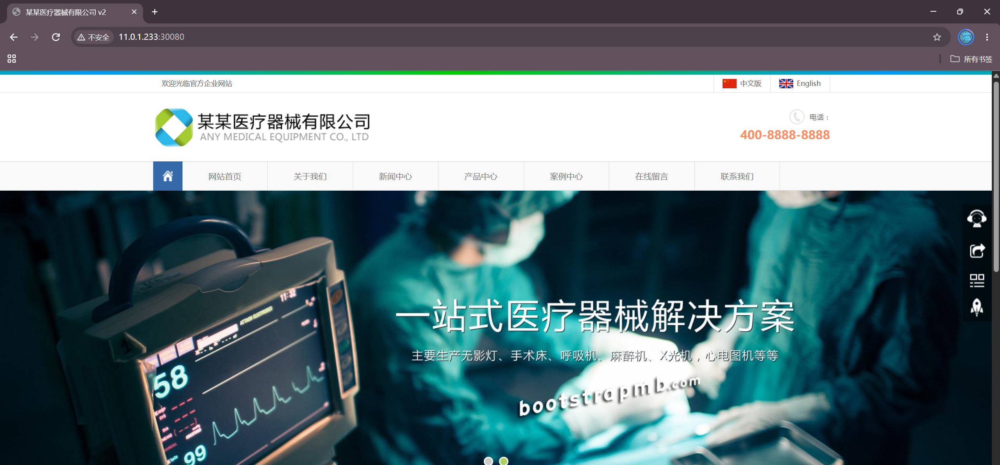

코드 수정 → docker build → push → kubectl 롤링 업데이트 → 웹 페이지 즉시 반영

## 8. Jenkins 사용자 정의 문자열 파라미터 기반 버전 빌드

Jenkins 작업에 "문자열 파라미터" 변수 `version`을 추가하고 스크립트를 다음과 같이 변경:

```bash
/root/update-version.sh ${version} && cd /root/dawn-yiliao-src && docker image build -t harbor:443/dawn-jenkins/yiliao:${version} . && docker push harbor:443/dawn-jenkins/yiliao:${version} && kubectl -n yiliao set image deploy deploy-yiliao yiliao=harbor:443/dawn-jenkins/yiliao:${version}
```

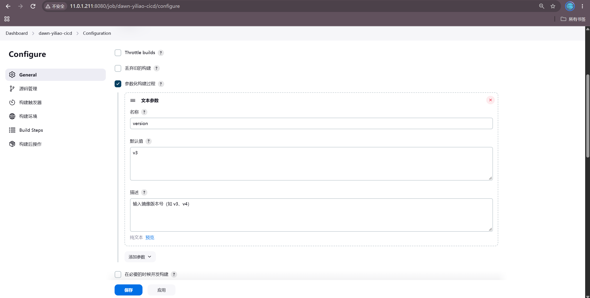

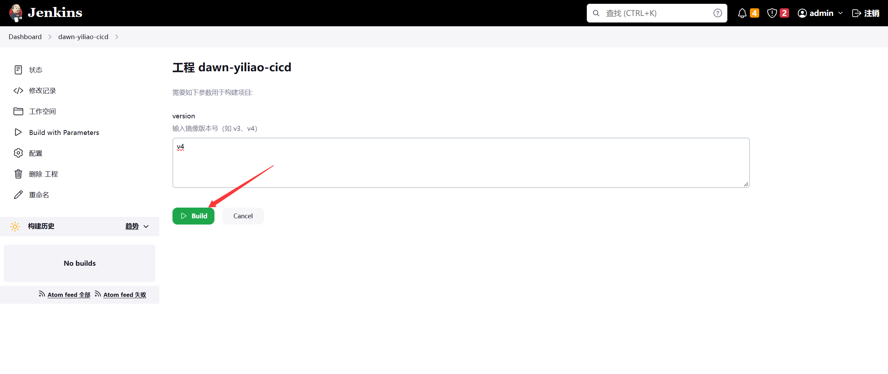

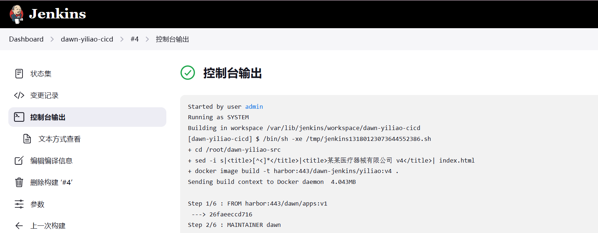

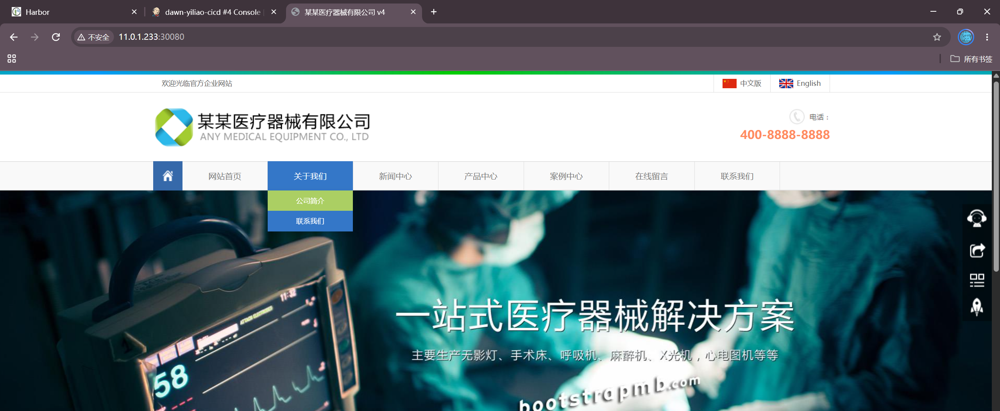

## 9. Jenkins 사용자 정의 옵션 파라미터 기반 버전 빌드

작업에 "옵션 파라미터" 변수 `tag` (`v1`, `v2`, `v3` 등 선택 옵션)를 추가하며 스크립트는 파라미터 형식을 사용합니다.

```bash
/root/update-version.sh ${tag} && cd /root/dawn-yiliao-src && docker image build -t harbor:443/dawn-jenkins/yiliao:${tag} . && docker push harbor:443/dawn-jenkins/yiliao:${tag} && kubectl -n yiliao set image deploy deploy-yiliao yiliao=harbor:443/dawn-jenkins/yiliao:${tag}
```

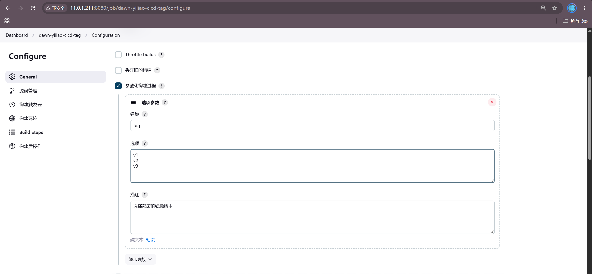

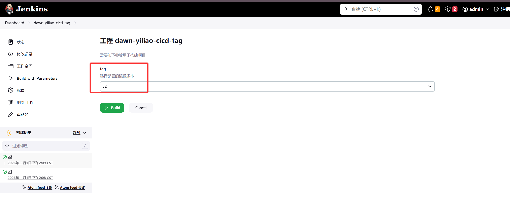

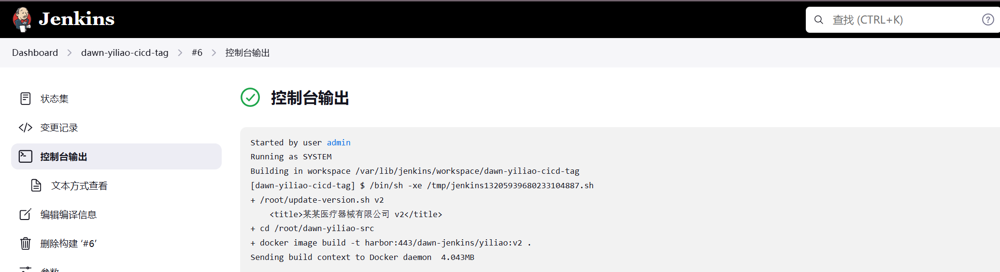

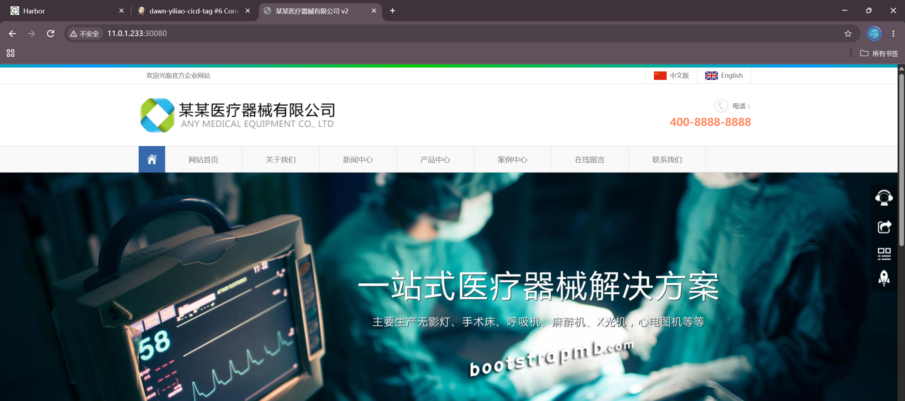

## 10. Jenkins Git 파라미터 기반 빌드

"Git Parameter" 변수 `release` (유형: Revision/Tag)를 추가하여 태그 기반 빌드를 구현합니다.

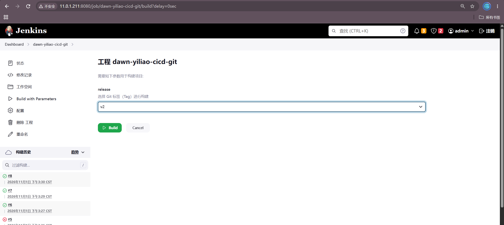

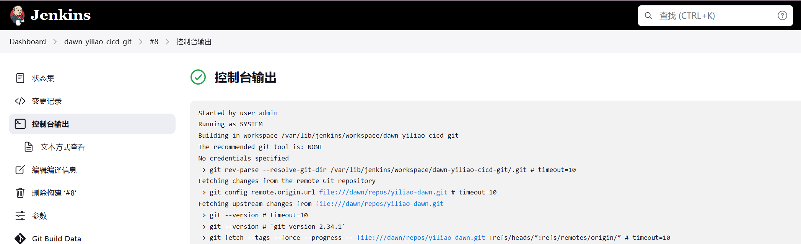

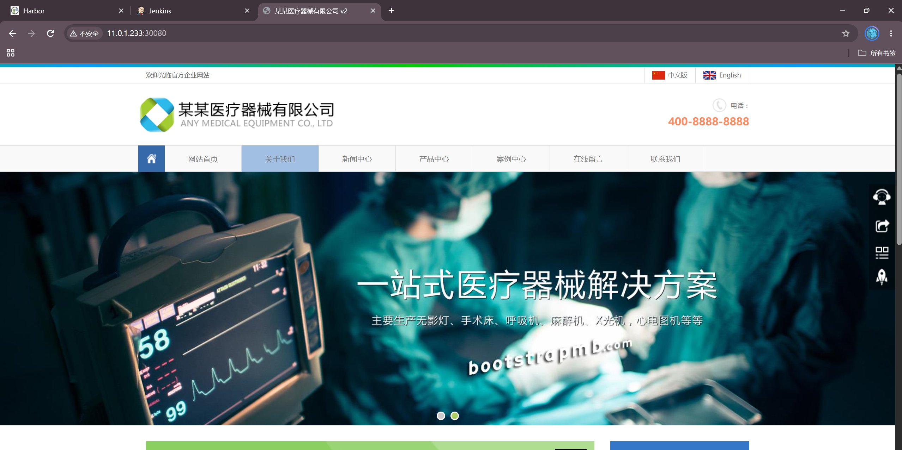

## 11. Jenkins를 통한 롤백 구현

Jenkins 자체가 직접 롤백을 수행하는 것은 아니며, 롤백은 K8S Deployment 고유의 기능입니다. 작업 스크립트를 통해 호출할 수 있습니다:

```bash
kubectl rollout undo deploy deploy-yiliao -n yiliao
```

또는 Jenkins에 별도의 "롤백" 작업을 생성하여 `kubectl rollout undo`를 통한 원클릭 롤백을 구현할 수도 있습니다

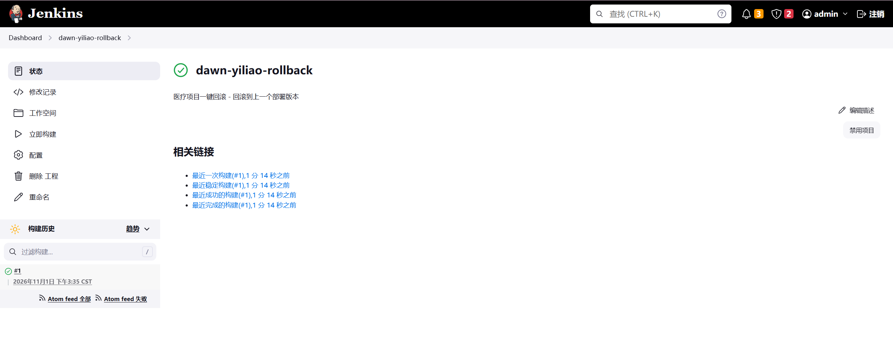

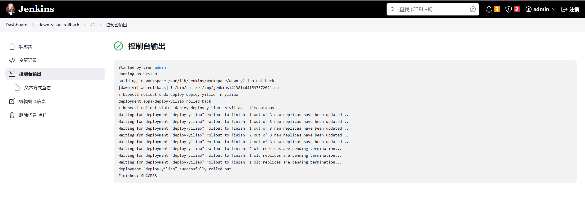