# K8S 与 Jenkins CI/CD 持续集成实战：Harbor 镜像联动、参数化构建与一键发布回滚

## 一、部署 Jenkins 环境

### 1. 时区设置

```bash
[root@jenkins ~]# ln -svf /usr/share/zoneinfo/Asia/Shanghai /etc/localtime
'/etc/localtime' -> '/usr/share/zoneinfo/Asia/Shanghai'
```

### 2. 安装 JDK 17

```bash
[root@jenkins ~]# mkdir -pv /dawn/softwares
[root@jenkins ~]# tar xf /dawn/softwares/jdk-17_linux-x64_bin.tar.gz -C /dawn/softwares/
[root@jenkins ~]# cat /etc/profile.d/jdk.sh
export JAVA_HOME=/dawn/softwares/jdk-17.0.8
export PATH=/dawn/softwares/jdk-17.0.8/bin:/usr/local/sbin:/usr/local/bin:/usr/sbin:/usr/bin:/sbin:/bin
[root@jenkins ~]# source /etc/profile.d/jdk.sh
[root@jenkins ~]# java --version
java 17.0.8 2023-07-18 LTS
Java(TM) SE Runtime Environment (build 17.0.8+9-LTS-211)
Java HotSpot(TM) 64-Bit Server VM (build 17.0.8+9-LTS-211, mixed mode, sharing)
```

### 2. 安装 fontconfig 与依赖

```bash
[root@jenkins ~]# apt-get update
[root@jenkins ~]# apt-get -y install fontconfig
```

### 3. 安装 Jenkins（离线 deb）

```bash
[root@jenkins ~]# dpkg -i /dawn/softwares/jenkins_2.426.3_all.deb
```

### 4. 修改 Jenkins 启动脚本

```bash
[root@jenkins ~]# vim /lib/systemd/system/jenkins.service
```

修改内容：

`User=root`（原 jenkins）

`Group=root`（原 jenkins）

在 `Environment="JENKINS_HOME=/var/lib/jenkins"` 下一行添加 `Environment="JAVA_HOME=/dawn/softwares/jdk-17.0.8"`

```bash
[root@jenkins ~]# systemctl daemon-reload
[root@jenkins ~]# systemctl restart jenkins
[root@jenkins ~]# systemctl is-active jenkins
active
```

### 5. 获取初始管理员密码

```bash
[root@jenkins ~]# cat /var/lib/jenkins/secrets/initialAdminPassword
20286530dae640598368e97991038d70
```

### 6. 安装插件（离线包一键导入）

```bash
[root@jenkins ~]# mkdir -p /var/lib/jenkins/plugins
[root@jenkins ~]# tar xf /dawn/softwares/dawn-jenkins211-plugins.tar.gz -C /var/lib/jenkins/plugins/
[root@jenkins ~]# ls /var/lib/jenkins/plugins/ | wc -l
148
[root@jenkins ~]# systemctl restart jenkins
```

148 个插件一次性导入（含 Git、Pipeline、Webhook、Ansible、Email、DingTalk、Git Parameter 等），无需逐个安装。

### 7. 配置镜像加速和修改搜索引擎地址

```bash
[root@jenkins ~]# sed -i.bak 's#updates.jenkins.io/download#mirror.tuna.tsinghua.edu.cn/jenkins#g' /var/lib/jenkins/updates/default.json
[root@jenkins ~]# sed -i 's#www.google.com#www.baidu.com#g' /var/lib/jenkins/updates/default.json
```

升级站点 URL：`https://mirror.tuna.tsinghua.edu.cn/jenkins/updates/update-center.json`

### 8. 访问 Jenkins WebUI

浏览器打开 `http://11.0.1.211:8080`，用初始密码登录后，完成配置

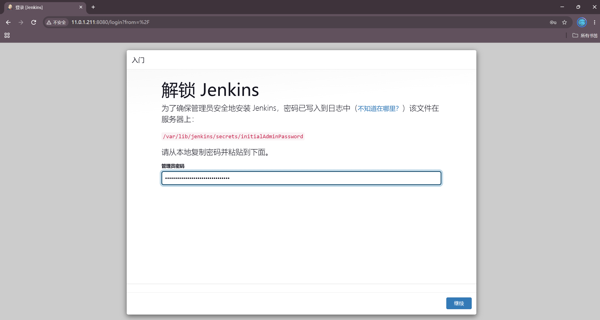

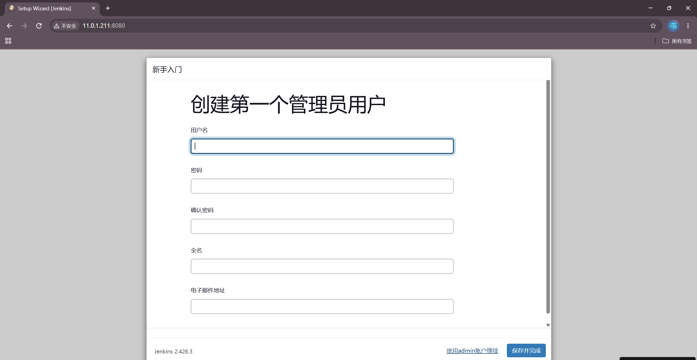

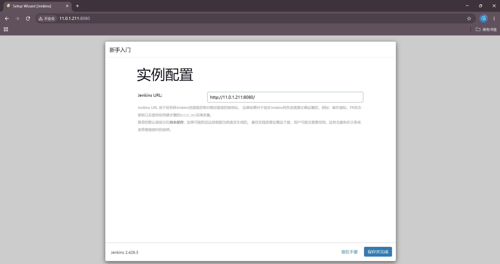

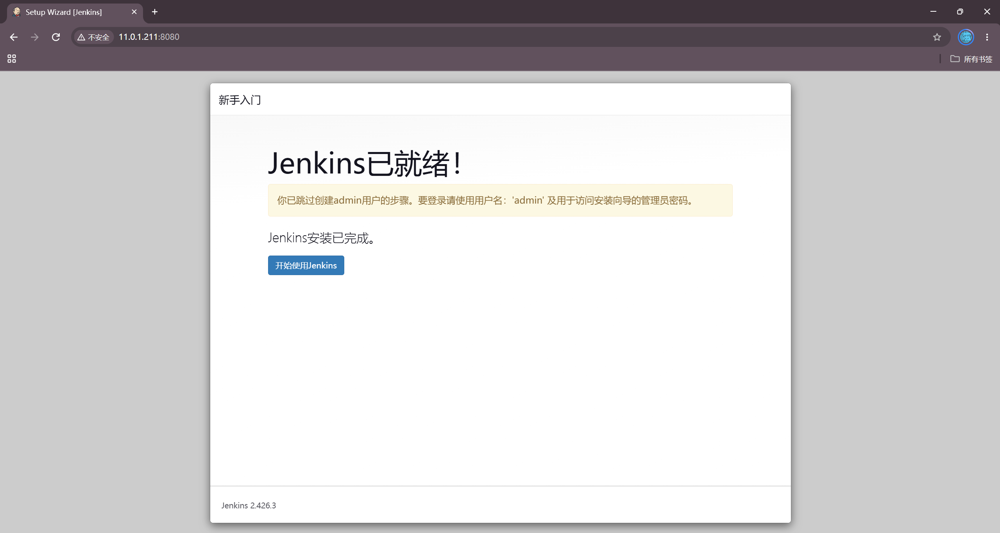

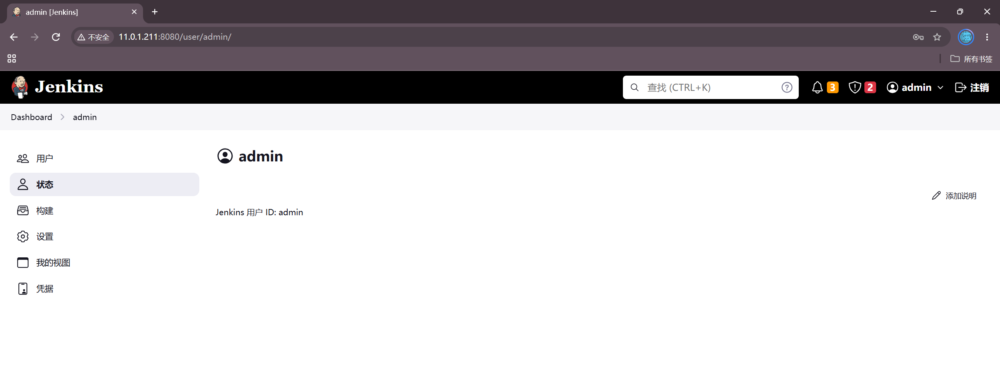

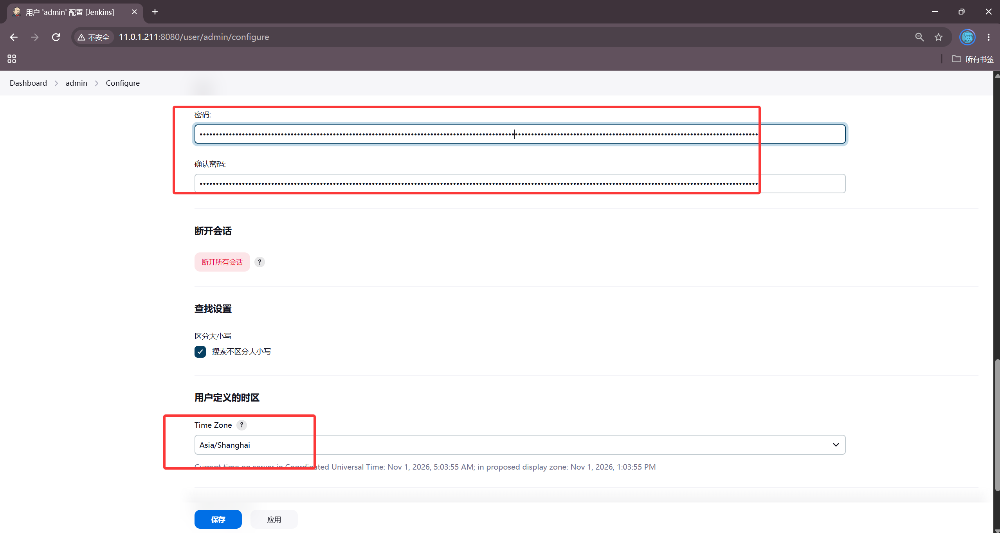

## 二、Jenkins 节点安装 Docker 与 Harbor 集成

### 1. 安装 Docker（二进制离线包）

```bash
[root@jenkins ~]# tar xf dawn-docker-compose-binary-install.tar.gz
[root@jenkins ~]# chmod +x install-docker.sh
[root@jenkins ~]# ./install-docker.sh install
Docker Compose version v2.23.0
安装成功...
```

### 2. 添加 Harbor 解析记录

```bash
[root@jenkins ~]# echo '11.0.1.250 harbor' >> /etc/hosts
```

### 3. 拷贝 Harbor 自建客户端证书

```bash
[root@jenkins ~]# apt-get install -y sshpass
[root@jenkins ~]# mkdir -p /etc/docker/certs.d/harbor
[root@jenkins ~]# sshpass -p '000000' scp -o StrictHostKeyChecking=no root@11.0.1.250:/dawn/softwares/harbor/certs/docker-client/* /etc/docker/certs.d/harbor/
[root@jenkins ~]# ll /etc/docker/certs.d/harbor/
total 20
-rw-r--r-- 1 root root 2037 Oct 31 21:01 ca.crt
-rw-r--r-- 1 root root 2102 Oct 31 21:01 harbor.cert
-rw------- 1 root root 3272 Oct 31 21:01 harbor.key
```

Docker 重启后生效：

```bash
[root@jenkins ~]# systemctl restart docker
[root@jenkins ~]# ln -sf /etc/docker/certs.d/harbor /etc/docker/certs.d/harbor:443
```

### 4. 登录 Harbor

```bash
[root@jenkins ~]# docker login harbor:443 -u admin -p Harbor12345
WARNING! Using --password via the CLI is insecure. Use --password-stdin.
Login Succeeded
```

### 5. 创建 Harbor 项目

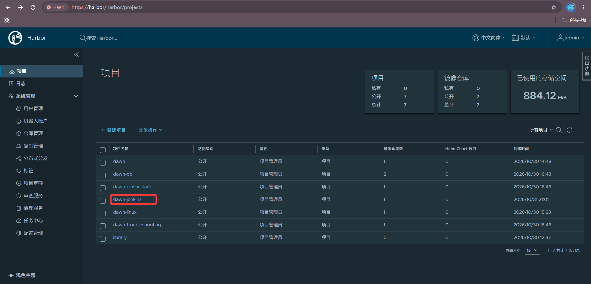

## 三、Jenkins 节点安装 kubectl 并接入 K8S

### 1. 安装 kubectl

```bash
[root@jenkins ~]# mv kubectl-1.23.17 /usr/local/sbin/kubectl
[root@jenkins ~]# chmod +x /usr/local/sbin/kubectl
[root@jenkins ~]# kubectl version --client
Client Version: version.Info{Major:"1", Minor:"23", GitVersion:"v1.23.17", ...}
```

### 2. 拷贝 K8S master 的 kubeconfig

```bash
[root@jenkins ~]# mkdir -pv ~/.kube/
[root@jenkins ~]# sshpass -p '000000' scp -o StrictHostKeyChecking=no 11.0.1.231:/root/.kube/config ~/.kube/
[root@jenkins ~]# kubectl get nodes
NAME       STATUS   ROLES                  AGE   VERSION
master     Ready    control-plane,master   32h   v1.23.17
worker01   Ready    <none>                 32h   v1.23.17
worker02   Ready    <none>                 32h   v1.23.17
```

三个节点全部 Ready，Jenkins 已具备直接操作 K8S 的能力

## 四、模拟开发人员编写代码并推送

用 Jenkins 本机 bare git 仓库：`/dawn/repos/yiliao-dawn.git`

### 1. 解压项目源码

```bash
[root@jenkins ~]# unzip dawn-yiliao.zip -d dawn-yiliao-src/
[root@jenkins ~]# cd dawn-yiliao-src
[root@jenkins dawn-yiliao-src]# ll
total 224
drwxr-xr-x 5 root root 4096 Aug  2 16:22 ./
-rw-r--r-- 1 root root 16458 Jun 13  2019 about.html
-rw-r--r-- 1 root root 20149 Jun 13  2019 album.html
-rw-r--r-- 1 root root 29627 Jun 29  2019 index.html
...
drwxr-xr-x 2 root root 4096 Sep 19  2022 css/
drwxr-xr-x 5 root root 4096 Sep 19  2022 images/
drwxr-xr-x 2 root root 4096 Sep 19  2022 js/
```

### 2. 编写 Dockerfile

```bash
[root@jenkins dawn-yiliao-src]# cat Dockerfile
FROM harbor:443/dawn/apps:v1

MAINTAINER dawn

LABEL auther=dawn \
      school=czu \
      class=computer01

EXPOSE 80

WORKDIR /usr/share/nginx/html/

ADD . /usr/share/nginx/html/
```

### 3. 初始化 git 并推送

```bash
[root@jenkins dawn-yiliao-src]# git config --global user.name "jenkins"
[root@jenkins dawn-yiliao-src]# git config --global user.email "admin@dawn.com"
[root@jenkins dawn-yiliao-src]# git init
[root@jenkins dawn-yiliao-src]# git add .
[root@jenkins dawn-yiliao-src]# git commit -m 'init yiliao v1'
[root@jenkins dawn-yiliao-src]# mkdir -p /dawn/repos
[root@jenkins dawn-yiliao-src]# git clone --bare . /dawn/repos/yiliao-dawn.git
```

## 五、K8S 部署医疗项目

```bash
[root@jenkins ~]# kubectl create namespace yiliao
namespace/yiliao created

[root@jenkins ~]# kubectl create deploy deploy-yiliao --image=harbor:443/dawn-jenkins/yiliao:v1 --replicas=3 -n yiliao
deployment.apps/deploy-yiliao created

[root@jenkins ~]# kubectl expose deploy deploy-yiliao --port=80 --target-port=80 --type=NodePort --name=yiliao-svc -n yiliao \
>   --overrides='{"spec":{"ports":[{"port":80,"targetPort":80,"nodePort":30080}]}}'
service/yiliao-svc exposed

[root@jenkins ~]# kubectl rollout status deploy deploy-yiliao -n yiliao --timeout=60s
deployment "deploy-yiliao" successfully rolled out

[root@jenkins ~]# kubectl get pods,svc -n yiliao -o wide
NAME                                READY   STATUS    RESTARTS   AGE    IP            NODE
pod/deploy-yiliao-9968fc7c8-4mz5t   1/1     Running   0          5m3s   10.100.1.92   worker01
pod/deploy-yiliao-9968fc7c8-92rxw   1/1     Running   0          5m3s   10.100.2.93   worker02
pod/deploy-yiliao-9968fc7c8-lgnf9   1/1     Running   0          5m3s   10.100.1.91   worker01

NAME                 TYPE       CLUSTER-IP       EXTERNAL-IP   PORT(S)        AGE
service/yiliao-svc   NodePort   10.200.113.198   <none>        80:30080/TCP   0s
```

**访问测试**

```bash
[root@jenkins ~]# curl -s http://11.0.1.233:30080 | grep '<title>'
    <title>某某医疗器械有限公司</title>
```

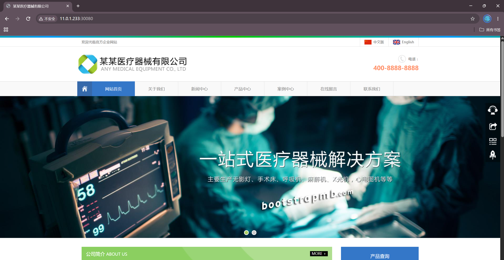

## 六、Jenkins 构建镜像并推送 Harbor

### 1. 手工构建测试

```bash
[root@jenkins dawn-yiliao-src]# docker build -t harbor:443/dawn-jenkins/yiliao:v1 .
Successfully built 9295379ea4af
Successfully tagged harbor:443/dawn-jenkins/yiliao:v1

[root@jenkins dawn-yiliao-src]# docker push harbor:443/dawn-jenkins/yiliao:v1
v1: digest: sha256:ec4de8a336e1dd2cafc89b717b4223576a3549b01fa8094375f4826b47fb4628

[root@jenkins dawn-yiliao-src]# docker images | grep yiliao
harbor:443/dawn-jenkins/yiliao   v1    9295379ea4af   ...   23.2MB
```

## 七、Jenkins 一键更新 K8S 应用（CICD 完整流程）

### 1. 创建 Jenkins 作业

作业名 `dawn-yiliao-cicd`（自由风格项目），Shell 构建步骤：

```bash
cd /root/dawn-yiliao-src && \
docker image build -t harbor:443/dawn-jenkins/yiliao:v2 . && \
docker push harbor:443/dawn-jenkins/yiliao:v2 && \
kubectl -n yiliao set image deploy deploy-yiliao yiliao=harbor:443/dawn-jenkins/yiliao:v2
```

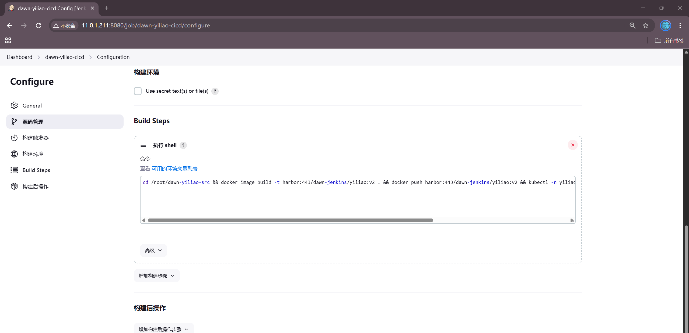

### 2. 模拟代码变更（v2）

修改 `index.html` 标题，构建 v2 镜像并更新 K8S：

```bash
[root@jenkins dawn-yiliao-src]# sed -i 's|<title>.*</title>|<title>某某医疗器械有限公司 v2</title>|' index.html
[root@jenkins dawn-yiliao-src]# git add . && git commit -m 'v2: update title'
[root@jenkins dawn-yiliao-src]# git push /dawn/repos/yiliao-dawn.git master
[root@jenkins dawn-yiliao-src]# docker build -t harbor:443/dawn-jenkins/yiliao:v2 .
Successfully built f52deb20e604
Successfully tagged harbor:443/dawn-jenkins/yiliao:v2

[root@jenkins dawn-yiliao-src]# docker push harbor:443/dawn-jenkins/yiliao:v2
v2: digest: sha256:c408f20094f32717fd915e6e3c1cf52ccebe8db32e4d88a8319a781e3696da7b

[root@jenkins dawn-yiliao-src]# kubectl -n yiliao set image deploy deploy-yiliao yiliao=harbor:443/dawn-jenkins/yiliao:v2
deployment.apps/deploy-yiliao image updated

[root@jenkins dawn-yiliao-src]# kubectl rollout status deploy deploy-yiliao -n yiliao --timeout=60s
Waiting for deployment "deploy-yiliao" rollout to finish:
  0 out of 3 new replicas have been updated...
  1 out of 3 new replicas have been updated...
  2 out of 3 new replicas have been updated...
  ...1 old replicas are pending termination...
deployment "deploy-yiliao" successfully rolled out
```

### 3. 验证更新

```bash
[root@jenkins ~]# curl -s http://11.0.1.233:30080 | grep '<title>'
    <title>某某医疗器械有限公司 v2</title>
```

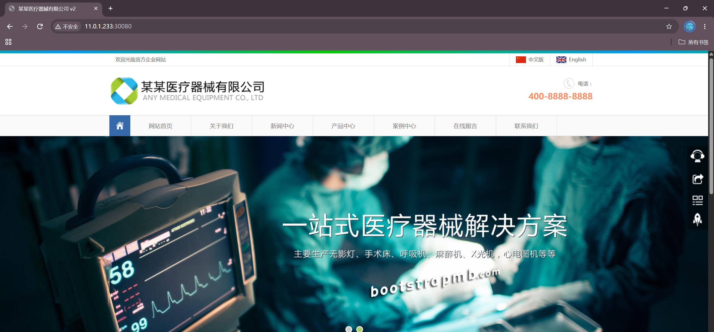

代码修改 → docker build → push → kubectl 滚动更新 → 页面生效

## 八、Jenkins 自定义文本参数进行版本构建

在 Jenkins 作业中添加"文本参数"变量 `version`，脚本改为：

```bash
/root/update-version.sh ${version} && cd /root/dawn-yiliao-src && docker image build -t harbor:443/dawn-jenkins/yiliao:${version} . && docker push harbor:443/dawn-jenkins/yiliao:${version} && kubectl -n yiliao set image deploy deploy-yiliao yiliao=harbor:443/dawn-jenkins/yiliao:${version}
```

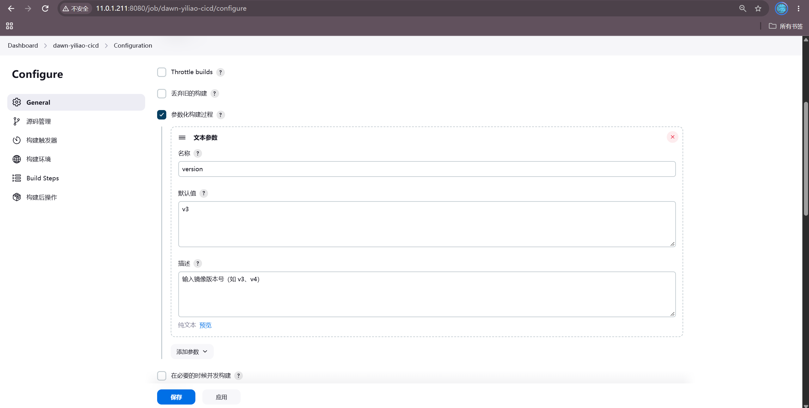

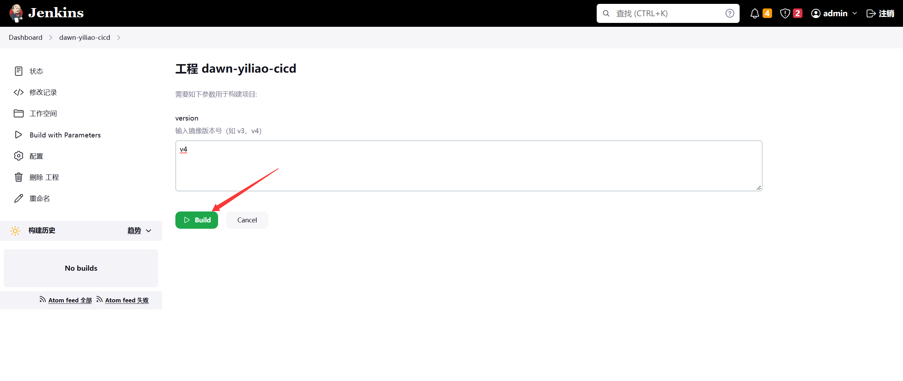

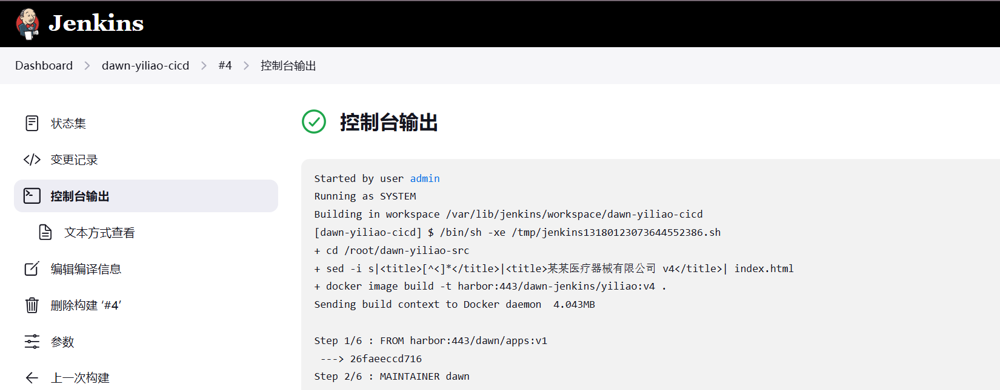

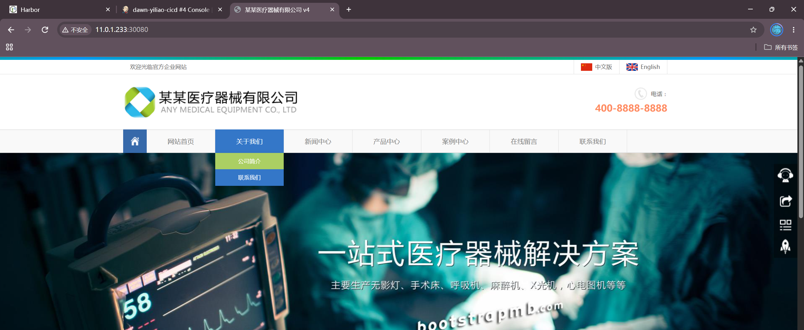

## 九、Jenkins 自定义选项参数进行版本构建

在作业中添加"选项参数"变量 `tag`（可选项如 `v1`, `v2`, `v3`），脚本同参数格式。

```bash
/root/update-version.sh ${tag} && cd /root/dawn-yiliao-src && docker image build -t harbor:443/dawn-jenkins/yiliao:${tag} . && docker push harbor:443/dawn-jenkins/yiliao:${tag} && kubectl -n yiliao set image deploy deploy-yiliao yiliao=harbor:443/dawn-jenkins/yiliao:${tag}
```

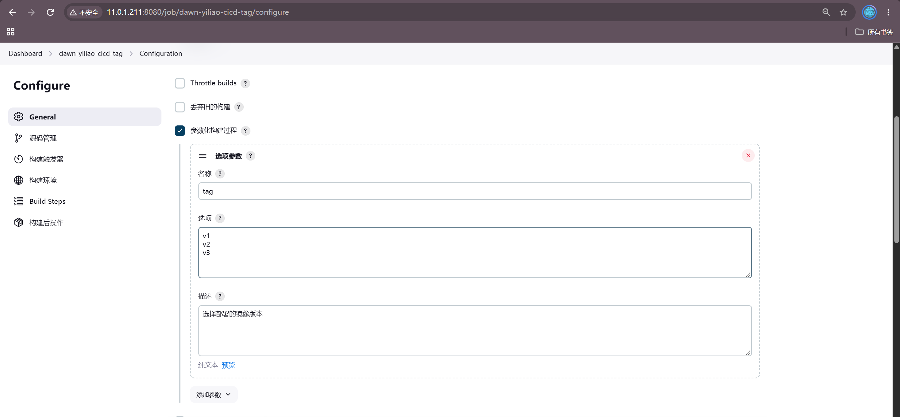

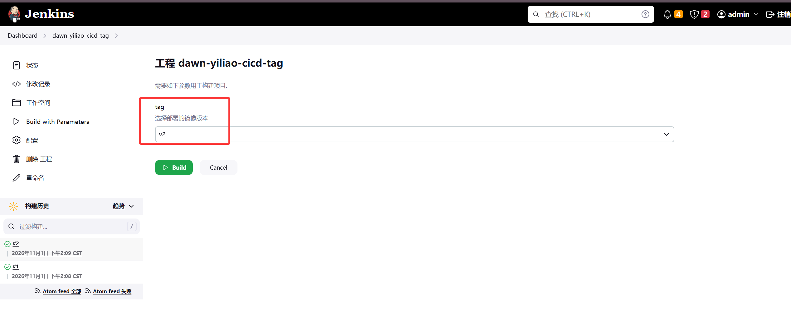

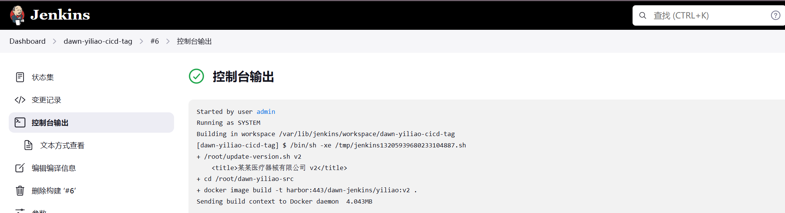

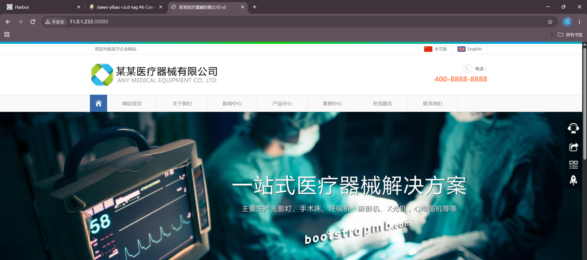

## 十、Jenkins 基于 Git 参数化构建

添加"Git Parameter"变量 `release`（类型为修订/标签），实现按 tag 构建。

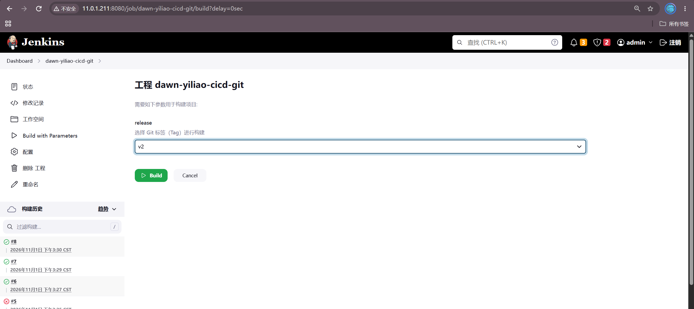

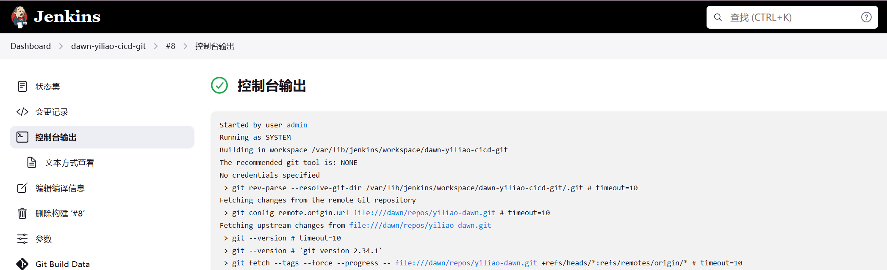

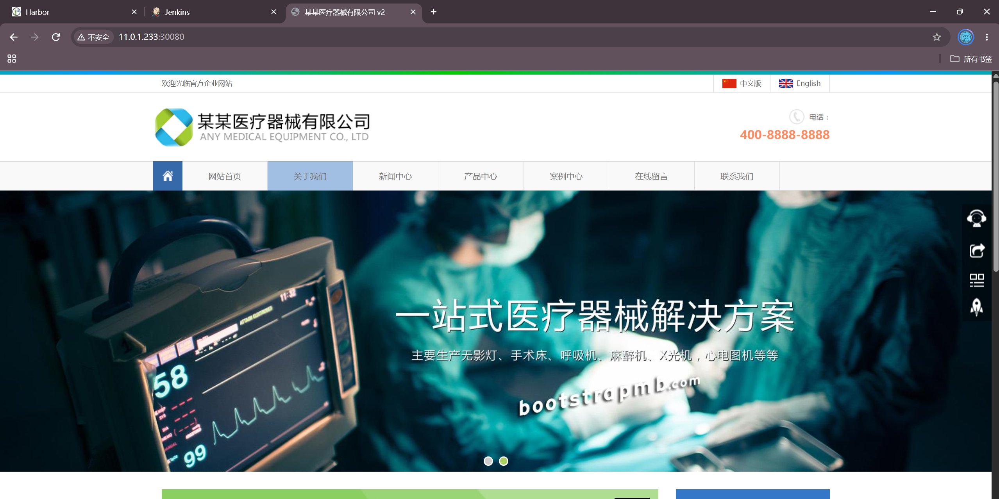

## 十一、Jenkins 实现回滚

Jenkins 本身不直接回滚——回滚是 K8S Deployment 的能力。可以通过作业脚本调用：

```bash
kubectl rollout undo deploy deploy-yiliao -n yiliao
```

或在 Jenkins 另建一个"回滚"作业，利用 `kubectl rollout undo` 实现一键回滚

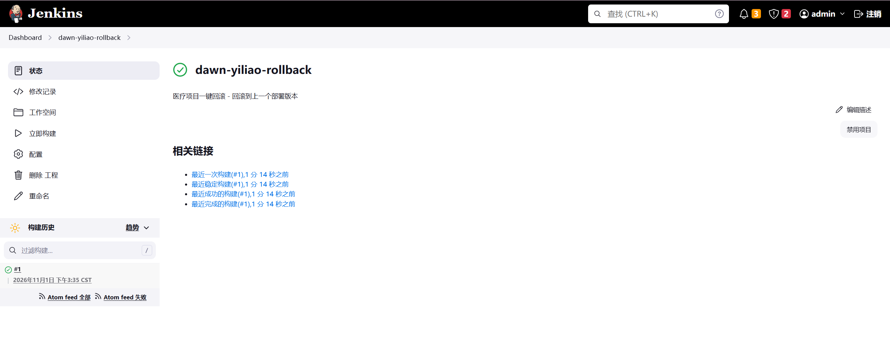

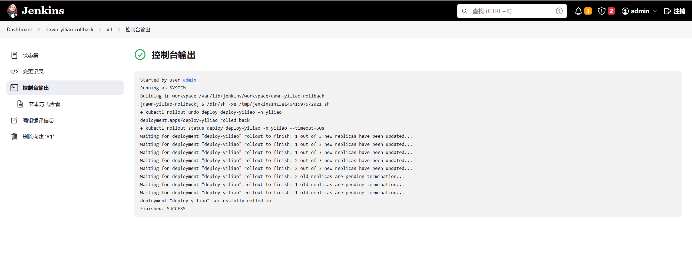