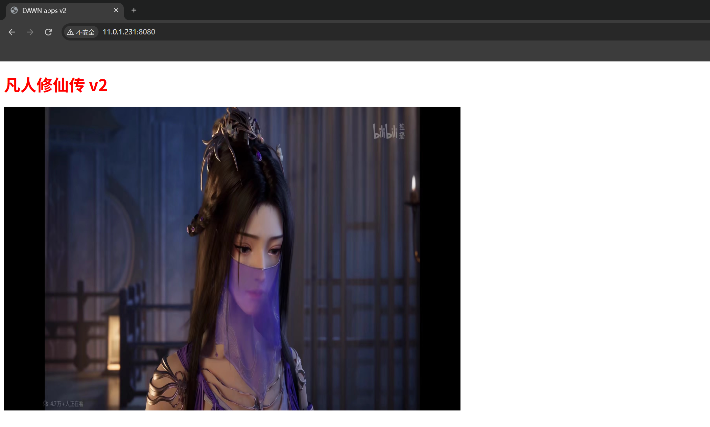

# K8S Service 타입 완벽 분석 및 외부 서비스 연동: MetalLB 구축, Endpoints 매핑 및 NodePort 범위 커스텀

## 1. Service 의 네 가지 타입

| 타입 | 접근 범위 | 적용 시나리오 |
| ---------------- | ------------------------ | ------------------------------------ |
| **ClusterIP**    | 클러스터 내부 전용 | 마이크로서비스 간 통신 (기본 타입) |
| **NodePort**     | 클러스터 외부 (노드 IP:포트) | 자체 구축 데이터센터 / 테스트 환경 서비스 노출 |
| **LoadBalancer** | 클러스터 외부 (가상 IP) | 클라우드 SLB 연동 또는 온프레미스 MetalLB 구성 |
| **ExternalName** | 클러스터 외부 (CNAME 도메인) | 프록시 대상 서비스가 클러스터 외부에 존재할 때 |

---

## 2. MetalLB: 온프레미스 환경에서 LoadBalancer 구현

클라우드 벤더의 LoadBalancer 는 매니지드 제품으로 제공되지만, 자체 구축 데이터센터에는 해당 기능이 없습니다. **MetalLB** 를 구축하여 이를 보완하며, "자체 데이터센터를 위한 SLB"로 이해할 수 있습니다.

### 2.1 MetalLB 배포

```bash
[root@master 01-metallb]# wget https://raw.githubusercontent.com/metallb/metallb/v0.14.8/config/manifests/metallb-native.yaml

[root@master 01-metallb]# kubectl apply -f metallb-native.yaml
namespace/metallb-system created
customresourcedefinition.apiextensions.k8s.io/ipaddresspools.metallb.io created
deployment.apps/controller created
daemonset.apps/speaker created
...

[root@master 01-metallb]# kubectl get pods -n metallb-system  -o wide
NAME                          READY   STATUS    RESTARTS   AGE   IP             NODE        NOMINATED NODE   READINESS GATES
controller-6679f7f994-kjmxl   1/1     Running   0          65s   10.100.2.131   worker02   <none>           <none>
speaker-nq69j                 1/1     Running   0          65s   11.0.1.232     worker01   <none>           <none>
speaker-smwml                 1/1     Running   0          65s   11.0.1.231     master     <none>           <none>
speaker-t2xpc                 1/1     Running   0          65s   11.0.1.233     worker02   <none>           <none>
```

### 2.2 주소 풀 및 L2 공고 생성

```bash
[root@master 01-metallb]# cat 02-metallb-ip-pool.yaml
```

```yaml
apiVersion: metallb.io/v1beta1
kind: IPAddressPool
metadata:
  name: dawn-pool
  namespace: metallb-system
spec:
  addresses:
  # 为MetalLB分配的IP地址（节点同网段空闲IP）
  - 11.0.1.150-11.0.1.180

---
apiVersion: metallb.io/v1beta1
kind: L2Advertisement
metadata:
  name: dawn-l2
  namespace: metallb-system
spec:
  ipAddressPools:
  - dawn-pool
```

```bash
[root@master 01-metallb]# kubectl apply -f 02-metallb-ip-pool.yaml
ipaddresspool.metallb.io/dawn-pool created
l2advertisement.metallb.io/dawn-l2 created
```

### 2.3 LoadBalancer 테스트 서비스 배포

```bash
[root@master 01-metallb]# cat 03-deploy-svc-xiuxian.yaml
```

```yaml
apiVersion: apps/v1
kind: Deployment
metadata:
  name: deloy-xiuxian
spec:
  replicas: 3
  selector:
    matchLabels:
      apps: xiuxian
  template:
    metadata:
      labels:
        apps: xiuxian
    spec:
       containers:
       - name: c1
         image: harbor:443/dawn/apps:v2

---
apiVersion: v1
kind: Service
metadata:
  name: xiuxian-svc-clusterip
spec:
  type: LoadBalancer
  selector:
    apps: xiuxian
  ports:
  - port: 80
    targetPort: 80
```

```bash
[root@master 01-metallb]# kubectl apply -f 03-deploy-svc-xiuxian.yaml
deployment.apps/deloy-xiuxian created
service/xiuxian-svc-clusterip created

[root@master 01-metallb]# kubectl get svc
NAME                    TYPE           CLUSTER-IP     EXTERNAL-IP   PORT(S)        AGE
kubernetes              ClusterIP      10.200.0.1     <none>        443/TCP        7d
xiuxian-svc-clusterip   LoadBalancer   10.200.82.73   11.0.1.150    80:30091/TCP   2m4s
```

EXTERNAL-IP 에 주소 풀의 첫 번째 IP가 자동 할당되며, 동시에 NodePort 도 함께 할당됩니다.

### 2.4 두 가지 접속 방식 검증

```bash
# 方式一：基于 MetalLB 提供的地址池访问
[root@master ~]# curl -s http://11.0.1.150/ | head -6
<!DOCTYPE html>
<html>
  <head>
    <meta charset="utf-8"/>
    <title>DAWN apps v2</title>

# 方式二：基于 NodePort 访问
[root@master ~]# curl -s http://11.0.1.232:30091/ | grep -o 'DAWN apps v[0-9]'
DAWN apps v2
[root@master ~]# curl -s http://11.0.1.233:30091/ | grep -o 'DAWN apps v[0-9]'
DAWN apps v2
```

### 2.5 EXTERNAL-IP 커스텀 지정 및 NodePort 고정

**방법 1: 리소스 어노테이션 (Annotations)**

```bash
[root@master 01-metallb]# cat 04-svc-EXTERNAL-IP.yaml
```

```yaml
apiVersion: v1
kind: Service
metadata:
  name: xiuxian-svc-lb-ip
  # 配置资源注解
  annotations:
    # IP地址范围必须在定义的IP地址池中，否则无法分配
    metallb.universe.tf/loadBalancerIPs: 11.0.1.155
spec:
  type: LoadBalancer
  selector:
    apps: xiuxian
  ports:
  - port: 80
    targetPort: 80
    nodePort: 30080
```

**방법 2: loadBalancerIP 필드**

```bash
[root@master 01-metallb]# cat 05-svc-EXTERNAL-IP.yaml
```

```yaml
apiVersion: v1
kind: Service
metadata:
  name: xiuxian-svc-lb-ip-2
spec:
  type: LoadBalancer
  loadBalancerIP: 11.0.1.160
  selector:
    apps: xiuxian
  ports:
  - port: 80
    targetPort: 80
    nodePort: 30090
```

```bash
[root@master 01-metallb]# kubectl apply -f 04-svc-EXTERNAL-IP.yaml
service/xiuxian-svc-lb-ip created

[root@master 01-metallb]# kubectl apply -f 05-svc-EXTERNAL-IP.yaml
service/xiuxian-svc-lb-ip-2 created

[root@master 01-metallb]# kubectl get svc
NAME                    TYPE           CLUSTER-IP       EXTERNAL-IP   PORT(S)        AGE
kubernetes              ClusterIP      10.200.0.1       <none>        443/TCP        7d
xiuxian-svc-clusterip   LoadBalancer   10.200.82.73     11.0.1.150    80:30091/TCP   12m
xiuxian-svc-lb-ip       LoadBalancer   10.200.194.230   11.0.1.155    80:30080/TCP   4m35s
xiuxian-svc-lb-ip-2     LoadBalancer   10.200.125.153   11.0.1.160    80:30090/TCP   3s
```

두 가지 방식 모두 지정한 IP를 성공적으로 획득하였으며, NodePort 도 정상적으로 고정되었습니다.

**참고 링크:** https://metallb.universe.tf/usage/

---

## 3. ExternalName: 클러스터 외부 서비스 도메인 매핑

```bash
[root@master svc]# cat 03-ExternerName.yaml
```

```yaml
apiVersion: v1
kind: Service
metadata:
  name: svc-cnblog
spec:
  # svc类型
  type: ExternalName
  # 指定外部域名
  externalName: www.cnblog.com
  # externalName: www.baidu.com
```

```bash
[root@master svc]# kubectl apply -f 03-ExternerName.yaml
service/svc-cnblog created

[root@master svc]# kubectl get svc
NAME                    TYPE           CLUSTER-IP      EXTERNAL-IP      PORT(S)        AGE
kubernetes              ClusterIP      10.200.0.1      <none>           443/TCP        7d
svc-cnblog              ExternalName   <none>          www.cnblog.com   <none>         3s
xiuxian-svc-clusterip   LoadBalancer   10.200.82.73    11.0.1.150       80:30091/TCP   40m

[root@master svc]# kubectl exec -it deloy-xiuxian-5d9475944b-5brqf -- sh
/ # ping svc-cnblog
PING svc-cnblog (198.20.0.36): 56 data bytes
64 bytes from 198.20.0.36: seq=0 ttl=127 time=1.053 ms
64 bytes from 198.20.0.36: seq=1 ttl=127 time=1.014 ms
^C
--- svc-cnblog ping statistics ---
3 packets transmitted, 3 packets received, 0% packet loss
round-trip min/avg/max = 1.014/1.541/2.558 ms
/ #
```

1. Pod 내에서 `svc-cnblog` 로 ping 을 보내는 것은 외부 도메인으로 ping 을 보내는 것과 동일합니다.

2. ExternalName 으로 매핑되는 서비스는 공인 DNS 또는 CoreDNS 컴포넌트 내에 도메인 해석 레코드가 존재해야 합니다.

3. 매핑하려는 K8S 클러스터 외부 서비스에 공인 도메인 네임 해석이 없는 경우, CoreDNS 레코드 설정을 수동으로 수정해야 합니다.

---

## 4. Endpoints: 외부 서비스를 매핑하는 또 다른 방식

### 4.1 Endpoints 란 무엇인가

각 Service 는 실제 백엔드 IP 레코드를 저장하는 동일한 이름의 Endpoints(ep) 리소스를 가집니다 (ExternalName 타입 제외). svc 를 삭제하면 동일한 이름의 ep 도 자동으로 삭제됩니다.

### 4.2 수동 ep 를 통한 외부 서비스 클러스터 편입

```bash
[root@master ep]# cat 01-ep-harbor.yaml
```

```yaml
apiVersion: v1
kind: Endpoints
metadata:
  name: dawn-harbor
# 定义ep资源的子集
subsets:
  # 指定服务的IP地址
- addresses:
    # 定义IP地址
  - ip: 11.0.1.250
  # 指定服务的端口
  ports:
    # 指的服务的端口号
  - port: 80
    name: http
  - port: 443
    name: https

---

apiVersion: v1
kind: Service
metadata:
  name: dawn-harbor
spec:
  type: ClusterIP
  ports:
  - port: 80
    name: http
  - port: 443
    name: https
```

```bash
[root@master ep]# kubectl apply -f 01-ep-harbor.yaml
endpoints/dawn-harbor created
service/dawn-harbor created

[root@master ep]# kubectl get -f 01-ep-harbor.yaml
NAME                         ENDPOINTS                      AGE
endpoints/dawn-harbor   11.0.1.250:80,11.0.1.250:443   3s

NAME                       TYPE        CLUSTER-IP      EXTERNAL-IP   PORT(S)          AGE
service/dawn-harbor   ClusterIP   10.200.99.146   <none>        80/TCP,443/TCP   3s

[root@master ep]# kubectl describe ep dawn-harbor
Name:         dawn-harbor
Namespace:    default
Subsets:
  Addresses:          11.0.1.250
  NotReadyAddresses:  <none>
  Ports:
    Name   Port  Protocol
    ----   ----  --------
    http   80    TCP
    https  443   TCP

[root@master ep]# kubectl describe svc dawn-harbor
Name:              dawn-harbor
Selector:          <none>
Type:              ClusterIP
IP:                10.200.99.146
Port:              http  80/TCP
TargetPort:        80/TCP
Endpoints:         11.0.1.250:80
Port:              https  443/TCP
TargetPort:        443/TCP
Endpoints:         11.0.1.250:443
```

svc 에 Selector 를 지정하지 않고 ep 에 수동으로 외부 IP 를 지정함으로써, Pod 내부에서 `https://dawn-harbor/` 를 통해 클러스터 외부의 Harbor 로 접근할 수 있습니다.

```bash
[root@master ~]# kubectl exec -it $(kubectl get pods -l apps=xiuxian -o jsonpath='{.items[0].metadata.name}') -- curl -k https://dawn-harbor/
<!DOCTYPE html>
<html>
    <head>
        <meta charset="utf-8"/>
        <title>Harbor</title>
        <base href="/"/>
        <meta name="viewport" content="width=device-width, initial-scale=1"/>
        <link rel="icon" type="image/x-icon" href="favicon.ico?v=2"/>
    <link rel="stylesheet" href="styles.778b44f8c96802aa.css"></head>
    <body>
        <harbor-app>
            <div class="spinner spinner-lg app-loading app-loading-fixed">
                Loading...
            </div>
        </harbor-app>
    <script src="runtime.fecb31573c19a80b.js" type="module"></script><script src="polyfills.d52770ae19691b1f.js" type="module"></script><script src="scripts.fc6b7827d4dcd875.js" defer></script><script src="main.6985c39c793f3a9f.js" type="module"></script></body>
</html>
```


**ExternalName vs Endpoints**: 외부 서비스에 도메인이 있고 이름 별칭(Alias)만 변경하려는 경우 ExternalName 을 사용합니다. 구체적인 IP:포트를 지정해야 하거나 외부 서비스에 도메인이 없는 경우에는 Endpoints 를 사용합니다.

---

## 5. NodePort 포트 범위 수정

### 5.1 기본 범위 30000-32767

```bash
[root@master svc]# cat 02-nodePort-xiuxian.yaml
```

```yaml
apiVersion: v1
kind: Service
metadata:
  name: xiuxian-svc-nodeport
spec:
  type: NodePort
  selector:
    school: czu
    apps: xiuxian
  ports:
  - port: 88
    targetPort: 80
    nodePort: 8080
```

```bash
[root@master svc]# kubectl apply -f 02-nodePort-xiuxian.yaml
The Service "xiuxian-svc-nodeport" is invalid: spec.ports[0].nodePort: Invalid value: 8080: provided port is not in the valid range. The range of valid ports is 30000-32767
```

### 5.2 apiserver 시작 파라미터 수정

```bash
[root@master ~]# vim /etc/kubernetes/manifests/kube-apiserver.yaml
 ...
 spec:
  containers:
  - command:
    - kube-apiserver
    - --service-node-port-range=3000-50000  # 进行添加这一行
    ...
```

매니페스트 파일을 이동시켰다가 다시 원위치하여 apiserver 재시작을 트리거한 후, 다시 apply 합니다:

```bash
[root@master svc]# kubectl apply -f 02-nodePort-xiuxian.yaml
service/xiuxian-svc-nodeport created

[root@master svc]# kubectl get -f 02-nodePort-xiuxian.yaml
NAME                   TYPE       CLUSTER-IP     EXTERNAL-IP   PORT(S)       AGE
xiuxian-svc-nodeport   NodePort   10.200.5.18    <none>        88:8080/TCP   5s
```

3개 노드 모두 `http://노드IP:8080/` 로 정상 접근 가능합니다.



**참고 링크:** https://kubernetes.io/zh-cn/docs/reference/command-line-tools-reference/kube-apiserver/
